# Attack Chain Overview

## Scenario

An external attacker discovers a vulnerable web application exposed through the firewall. The attacker exploits DVWA, gains command execution in the DMZ, creates a tunnel into the internal network, accesses a Windows endpoint with a recovered service credential, discovers Active Directory, and performs Kerberoasting.

## Attack Path

```mermaid
flowchart LR
    Kali["Kali attacker"]
    OPNsense["OPNsense firewall"]
    DVWA["DVWA container<br/>DMZ"]
    Win10["Windows 10 client<br/>LAB&#92;svc_web"]
    DC["AD-DC01"]
    Hash["svc_sql Kerberoast hash"]
    Credential["Valid svc_sql credential<br/>and TGT"]

    Kali -->|"TCP 8080"| OPNsense
    OPNsense -->|"Destination NAT"| DVWA
    DVWA -->|"Reverse shell and<br/>Chisel SOCKS tunnel"| Win10
    Win10 -->|"Second Chisel<br/>SOCKS tunnel"| DC
    DC -->|"Kerberos TGS request"| Hash
    Hash -->|"Offline password recovery"| Credential
```

## Phase Mapping

| Phase | Activity | MITRE ATT&CK | CKC |
|---|---|---|---|
| 1 | External scanning and fingerprinting | T1046, T1595 | Reconnaissance |
| 2 | SQL injection against DVWA | T1190 | Exploitation |
| 3 | Command injection and reverse shell | T1059 | Exploitation / Installation |
| 4 | Chisel tunnelling and WinRM access | T1572, T1021.006 | Command and Control / Actions |
| 5 | Domain and account discovery | T1087.002, T1018 | Actions on Objectives |
| 6 | Kerberoasting | T1558.003 | Actions on Objectives |
| 7 | Offline password recovery | T1110.002 | Actions on Objectives |
| 8 | Successful TGT request | T1078 | Actions on Objectives |

## Intentional Lab Weaknesses

- DVWA is intentionally vulnerable and exposed through NAT.
- DMZ-to-Windows WinRM access was temporarily permitted for the scenario.
- `svc_web` was allowed to use remote management on Windows 10.
- `svc_sql` was assigned MSSQL-style SPNs.
- `svc_sql` used a controlled, recoverable lab password.
- Chisel communication over TCP 443 was temporarily permitted.

These are documented test conditions, not recommended production configurations.

## Completed Evidence

- Nmap and WhatWeb identification of DVWA
- Gobuster content enumeration
- Suricata Nmap alerts
- SQLmap database enumeration
- DVWA user-table extraction
- Reverse shell as `www-data`
- Chisel SOCKS listeners on ports `1080` and `1081`
- Evil-WinRM access as `LAB\svc_web`
- Domain controller discovery
- Event 4769 for the Kerberoasting request
- Offline recovery of the controlled service-account password
- Event 4768 for successful `svc_sql` authentication

## Next Phase

Continue with [[09 - Authorization Assessment]] before making any new privilege or lateral-movement assumptions.
