# Attack Chain Overview

## Scenario

An external attacker discovers a vulnerable web application exposed through the
firewall. The attacker exploits DVWA, gains command execution in the DMZ, creates
a tunnel into the internal network, accesses a Windows endpoint, discovers Active
Directory, exercises a controlled local `svc_web`-to-SYSTEM service-file
weakness, performs Kerberoasting, validates the recovered service credential,
tests its authorization boundaries, and establishes controlled persistence/C2
on the Windows endpoint.

## Attack Path

```mermaid
flowchart LR
    Kali["Kali attacker"]
    OPNsense["OPNsense firewall"]
    DVWA["DVWA container<br/>DMZ"]
    Win10["Windows 10 client<br/>LAB&#92;svc_web"]
    PrivEsc["Writable lab service script<br/>LocalSystem execution"]
    SystemProof["SYSTEM proof<br/>SID S-1-5-18"]
    DC["AD-DC01"]
    Hash["svc_sql Kerberoast hash"]
    Credential["Valid svc_sql credential<br/>and TGT"]
    Authz["Authorization assessment<br/>NETLOGON allowed / C$ denied"]
    Persist["HKCU Run persistence<br/>PowerShell and Chisel"]
    Spray["Supplemental password spray<br/>4771 telemetry validated"]

    Kali -->|"TCP 8080"| OPNsense
    OPNsense -->|"Destination NAT"| DVWA
    DVWA -->|"Reverse shell and<br/>Chisel SOCKS tunnel"| Win10
    Win10 -->|"Modify script as svc_web"| PrivEsc
    PrivEsc -->|"Service executes"| SystemProof
    Win10 -->|"Second Chisel<br/>SOCKS tunnel"| DC
    DC -->|"Kerberos TGS request"| Hash
    Hash -->|"Offline password recovery"| Credential
    Credential --> Authz
    Authz --> Persist
    Persist --> Spray
```

## Phase Mapping

| Phase | Activity                                 | MITRE ATT&CK                | CKC                                |
| ----- | ---------------------------------------- | --------------------------- | ---------------------------------- |
| 1     | External scanning and fingerprinting     | T1046, T1595                | Reconnaissance                     |
| 2     | SQL injection against DVWA               | T1190                       | Exploitation                       |
| 3     | Command injection and reverse shell      | T1059                       | Exploitation / Installation        |
| 4     | Chisel tunnelling and WinRM access       | T1572, T1021.006            | Command and Control / Actions      |
| 5     | Domain and account discovery             | T1087.002, T1018            | Actions on Objectives              |
| 5A    | Writable service script to local SYSTEM  | T1574.010, T1059.001        | Privilege Escalation               |
| 6     | Kerberoasting                            | T1558.003                   | Actions on Objectives              |
| 7     | Offline password recovery                | T1110.002                   | Actions on Objectives              |
| 8     | Successful TGT request                   | T1078                       | Actions on Objectives              |
| 9     | Share and WinRM authorization assessment | T1135, T1021.006            | Actions on Objectives              |
| 10    | Run-key persistence and Chisel C2        | T1547.001, T1059.001, T1572 | Installation / Command and Control |
| 11    | Controlled password spraying             | T1110.003, T1078            | Actions on Objectives              |

## Intentional Lab Weaknesses

- DVWA is intentionally vulnerable and exposed through NAT.
- DMZ-to-Windows WinRM access was temporarily permitted for the scenario.
- `svc_web` was allowed to use remote management on Windows 10.
- The lab-owned `PFA-Lab-Updater` service intentionally loads one script that
  `svc_web` can modify while the service itself runs as LocalSystem.
- `svc_sql` was assigned MSSQL-style SPNs.
- `svc_sql` used a controlled, recoverable lab password.
- Chisel communication over TCP 443 was temporarily permitted.

These are documented test conditions, not recommended production configurations.

## Completed Evidence

- Nmap and WhatWeb identification of DVWA
- Gobuster content enumeration
- Suricata Nmap alerts
- SQLmap database enumeration
- DVWA user-table extraction
- Reverse shell as `www-data`
- Chisel SOCKS listeners on ports `1080` and `1081`
- Evil-WinRM access as `LAB\svc_web`
- Domain controller discovery
- Event 4769 for the Kerberoasting request
- Offline recovery of the controlled service-account password
- Event 4768 for successful `svc_sql` authentication
- SMB authorization results: `NETLOGON` readable and `C$` denied
- WinRM authorization failure for least-privileged `svc_sql`
- Event 192 in the WinRM Operational log
- Process Creation Event 4688 with command line
- PowerShell Script Block Event 4104
- HKCU Run persistence and Chisel process execution
- Controlled password-spray results: Alice Event 4768 plus `svc_web` and
  `svc_sql` Event 4771 failures from `10.10.30.20`

The privilege-escalation replay produced verified SYSTEM proof in run
`PTR-20260909T162419Z-355a0dc0`. It recorded `LAB\svc_web` as the file writer,
`NT AUTHORITY\SYSTEM` as the executor, changed before/after hashes, process
lineage and a successful Application-event write. Splunk telemetry correlation
is not yet listed as completed because monitoring was intentionally off during
the attack-only run.

## Current Defensive Handoff

Preserve the completed attack proof for the report baseline, then start the
monitoring phase for [[05A - Local Privilege Escalation]] and correlate its
file writer, service execution and SYSTEM process evidence in Splunk before
resetting the endpoint fixture. The Enterprise Developer license and full
dashboard are now active; see [[Splunk License and Executive Dashboard]]. The
supplemental password-spray telemetry and D03 manual search are validated; only
the current scheduled-alert/trigger state remains to be audited in
[[11 - Controlled Password Spraying]].
