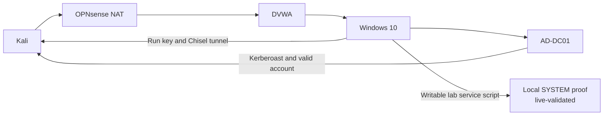

# CBI Cybersecurity Internship Lab

## Project

**Title:** Offensive and Defensive Cybersecurity Lab  
**Student:** Mariam Ibni  
**Company:** CBI  
**Supervisor:** Yassine Medouar

## Current Objective

Build and evaluate a segmented purple-team laboratory that combines:

- External attack simulation
- DMZ exploitation
- Internal network pivoting
- Active Directory attacks
- Centralized monitoring with Splunk
- Network detection with OPNsense and Suricata
- Automated response with Shuffle SOAR

## Navigation

### Infrastructure

- [[Network Architecture]]
- [[Assets and Addressing]]
- [[Firewall and Routing]]
- [[Security Monitoring Architecture]]

### Attack Chain

- [[Attack Chain Overview]]
- [[01 - External Reconnaissance]]
- [[02 - DVWA Web Exploitation]]
- [[03 - DMZ Reverse Shell]]
- [[04 - DMZ to Windows Pivot]]
- [[05 - Active Directory Discovery]]
- [[05A - Local Privilege Escalation]]
- [[06 - Kerberoasting]]
- [[07 - Offline Password Recovery]]
- [[08 - Valid Account Validation]]
- [[09 - Authorization Assessment]]
- [[10 - Persistence and C2 Simulation]]
- [[11 - Controlled Password Spraying]]

### Defensive Work

- [[Detection Coverage Matrix]]
- [[Phase 2 Web Exploitation Detections]]
- [[Phase 3 DMZ Pivot and Internal Access Detections]]
- [[Splunk Data Sources and Searches]]
- [[Splunk License and Executive Dashboard]]
- [[Detection Gap Register]]
- [[Defensive Improvement Backlog]]
- [[Splunk and Shuffle Integration]]
- [[PB04 - Active Directory Credential Access and Account Abuse]]
- [[PB05 - Endpoint Persistence and C2 Investigation and Containment]]

### Documentation

- [[Evidence Index]]
- [[Project Progress]]
- [[Report Outline]]
- [[Report Architecture and Presentation Strategy]]
- [[Report Writing Handoff]]

## Current Status

| Phase                                   | Status                                    |
| --------------------------------------- | ----------------------------------------- |
| Infrastructure deployment               | Completed                                 |
| External reconnaissance                 | Completed                                 |
| DVWA SQL injection                      | Completed                                 |
| DMZ command execution                   | Completed                                 |
| Reverse shell                           | Completed                                 |
| Pivot through DVWA                      | Completed                                 |
| Windows 10 access                       | Completed                                 |
| Active Directory discovery              | Completed                                 |
| Local service privilege escalation       | Completed; Splunk validation pending      |
| Kerberoasting                           | Completed                                 |
| Offline password recovery               | Completed                                 |
| Valid-account validation                | Completed                                 |
| Authorization assessment                | Completed                                 |
| Controlled lateral access to Windows 10 | Completed                                 |
| Persistence simulation                  | Completed; retained for detection testing |
| C2/tunnelling simulation                | Completed                                 |
| Controlled password spray               | Supplemental validation completed; Event 4771 and D03 manual search proven; current scheduled-trigger state to audit |
| Phase 1 reconnaissance detections       | Completed and live-validated              |
| Phase 2 web-exploitation detections     | Completed and live-validated              |
| Phase 3 pivot/internal detections       | Completed and live-validated              |
| Splunk Enterprise Developer license     | Active; 10 GB/day through 6 March 2027    |
| Purple Team Executive Overview          | Full 12-panel dashboard restored and validated |
| Telemetry-health alerting               | OPS01 completed and live-validated        |
| Alert configuration audit               | Completed; schedules staggered            |
| Defensive improvements                  | In progress                               |
| Shuffle PB01 for D13                     | Historical experiment; no longer the main design |
| Shuffle PB02 reconnaissance response     | Functionally complete; rollback policy deferred |
| Shuffle PB03 web-exploitation response   | CP2 and CP3 live-validated successfully   |
| Shuffle PB04 identity response           | Complete; IRP2 and IRP3 live-validated    |
| Shuffle PB05 endpoint/C2 response         | Complete; CRP1-CRP4 and native approval live-validated |
| Additional Shuffle playbooks             | Current planned playbook set complete     |

## Current Attack Position

The lab has progressed from an external Kali host to a compromised DMZ application,
two controlled pivots, service-account credential recovery, authorization testing,
an isolated local privilege-escalation fixture, and a user-level persistence/C2
simulation:

The last documented saved-alert audit contained 21 enabled,
Application-shared production alerts spanning
reconnaissance, web exploitation, DMZ pivoting, internal access, Kerberoasting,
valid-account use, persistence, tunneling, and telemetry health. Event `4771`
failure telemetry and the D03 manual search were subsequently validated, and a
historical screenshot shows D03 enabled. Its current scheduled state and a
trigger record must be reconciled with the later audit before the final catalog
is exported. The obsolete OPS01 clone and Shuffle test alert are intentionally
retained disabled. Scheduler
baselining and optimization are complete for D13, D15, and D18. PB01 is kept
as historical experimentation rather than the current SOAR design. PB02 is
functionally complete for reconnaissance response, and PB03 validated CP2 and
CP3 web-exploitation containment. PB04 is complete for the current identity
scope: D14 and D15 investigation, analyst-gated IRP2/IRP3 response, temporary
AD account disable, post-response Splunk verification, final audit, cleanup,
and manual recovery were validated end to end. PB05 is also complete for D17
and D18: native analyst approval, scoped OPNsense C2 containment, exact process
and Run-value removal, independent verification, final audit, and notification
were live-validated through CRP1-CRP4. The Chisel binary and persistence script
remain preserved for evidence and manual remediation.

The isolated service-file privilege-escalation replay is also live-validated.
Run `PTR-20260909T162419Z-355a0dc0` preserved the causal chain from
`LAB\svc_web` modifying the vulnerable script to a service-launched
`NT AUTHORITY\SYSTEM` PowerShell process and structured proof. Splunk and
Shuffle remained stopped, so central ingestion and correlation are the next
validation step.

The expired Trial group has been replaced by the active Enterprise Developer
license. The full Dashboard Studio definition is restored: an `All time`
validation returned 799,276 indexed events, 10 active sourcetypes, 25 enabled
project detections and 2,692 historical detection hits. See
[[Splunk License and Executive Dashboard]].

## Presentation and Remaining Work

The current priority is to prepare a stable report/presentation baseline from
the validated architecture, attack chain, detections, automation and SOAR
results. Optional Shuffle ticketing and workflow refinements can be added later
and incorporated as report revisions.

Before resetting the privilege-escalation fixture, validate its preserved
Windows evidence in Splunk. This pending SIEM check must not be described as
completed detection coverage yet.

## Safety Notes

- This vault documents an isolated and authorized laboratory.
- Do not store passwords, session cookies, API keys, or active tokens here.
- Use `[REDACTED]` when a secret appears in evidence.
- Take VM snapshots before changes that affect authentication, routing, or security controls.
