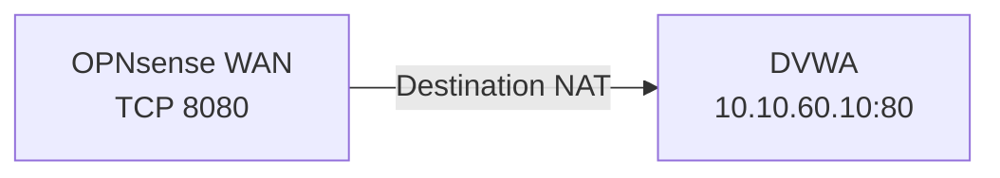
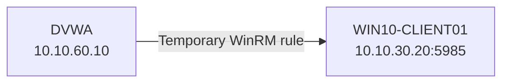

# Firewall and Routing

## OPNsense Responsibilities

- Terminates the external network.
- Publishes DVWA using destination NAT.
- Routes the dedicated DMZ.
- Connects to Cisco R1 through `10.10.70.0/30`.
- Enforces zone-to-zone policy.
- Runs Suricata IDS.
- Sends firewall and IDS logs to Splunk.

## Cisco R1 Responsibilities

- Routes internal VLANs.
- Provides gateways such as `10.10.30.1` and `10.10.50.1`.
- Uses OPNsense at `10.10.70.1` as its default route.
- Uses static routes where needed between OPNsense, the DMZ, and internal networks.

## Important Rules

### External to DVWA

Destination NAT maps:



This lets Kali reach DVWA without exposing the DMZ host directly on the external network.

### DMZ to Splunk

The DVWA Universal Forwarder must reach:

```text
10.10.50.10:9997/TCP
```

This should be allowed and logged.

### Temporary DMZ to Windows Rule

The attack scenario temporarily allowed:



This was required for the controlled WinRM lateral-movement scenario. It is an intentional weakness and should be removed or disabled during the defensive phase.

### Temporary Tunnel Traffic

Narrow TCP 443 rules were temporarily used for Chisel callbacks. These rules must be clearly identified as lab-only rules.

## Troubleshooting Method

Use this order:

1. Check interface status.
2. Check local IP and subnet.
3. Check the route selected for the destination.
4. Ping the local gateway if ICMP is allowed.
5. Check ARP or neighbor resolution.
6. Test the exact TCP port.
7. Inspect OPNsense live firewall logs.
8. Capture packets on the relevant OPNsense interface.
9. Confirm the destination service is listening.

Ping failure alone does not prove TCP connectivity is broken because ICMP may be blocked while the required service is permitted.
