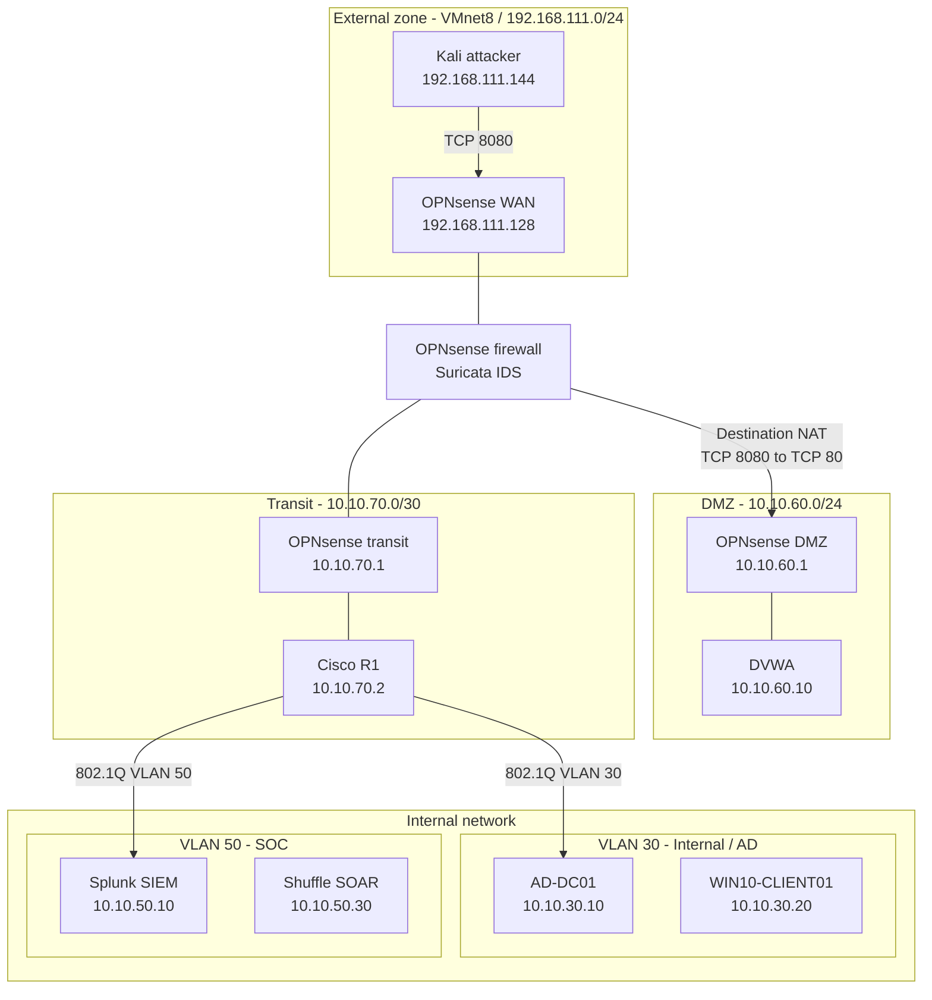

# Network Architecture

## Design Summary

The project uses VMware Workstation for endpoint and security VMs and GNS3 for routing and switching. OPNsense separates the external, DMZ, transit, and internal networks.

## Logical Topology

## Internal Routing

Cisco R1 provides router-on-a-stick routing for the internal VLANs. OPNsense controls traffic entering or leaving the DMZ and traffic crossing the firewall transit.

## Security Zones

| Zone | Network | Purpose |
|---|---|---|
| External | `192.168.111.0/24` | Kali and OPNsense WAN |
| Transit | `10.10.70.0/30` | OPNsense-to-R1 routed link |
| Internal / AD | `10.10.30.0/24` | Domain controller and Windows client |
| SOC | `10.10.50.0/24` | Splunk and Shuffle |
| DMZ | `10.10.60.0/24` | Public-facing DVWA server |

## Design Rationale

- The DMZ is directly connected to OPNsense and is not an internal VLAN.
- Public access to DVWA is provided through destination NAT rather than direct routing.
- Internal systems are not directly exposed to the external network.
- SOC systems receive logs from all relevant zones.
- Temporary attack-simulation rules are narrow, logged, and should be removed after testing.

## Important Operational Detail

The lab depends on VMware virtual adapters, GNS3 Cloud nodes, Cisco interfaces, and OPNsense interfaces all being active. A link that appears configured may still fail at Layer 2 after suspend, resume, or moving VM files.

Always verify:

1. VMware adapter is connected.
2. GNS3 node and Cloud link are running.
3. Router interface is up/up.
4. ARP resolves.
5. Route exists in both directions.
6. OPNsense rule permits the traffic.
