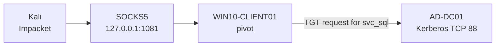

# 08 - Valid Account Validation

## Objective

Confirm that the password recovered during offline analysis was still valid without assuming that the account had administrative privileges.

## TGT Request

Impacket requested a Kerberos Ticket Granting Ticket for `svc_sql` through the Windows 10 SOCKS pivot.



The domain controller accepted the credential and returned a TGT.

## Credential Cache

The ticket was saved as:

```text
/tmp/svc_sql.ccache
```

With `KRB5CCNAME` pointing to that file, `klist` showed:

```text
Default principal: svc_sql@LAB.LOCAL
Service: krbtgt/LAB.LOCAL@LAB.LOCAL
```

## Event 4768

AD-DC01 generated Security Event `4768`:

| Field | Meaning |
|---|---|
| Account | `svc_sql` |
| Realm | `LAB.LOCAL` |
| Service | `krbtgt` |
| Client | `10.10.30.20` |
| Result | `0x0`, successful |
| Encryption | `0x12`, AES-256 |
| Pre-authentication | `2`, password-derived encrypted timestamp |

## Difference Between Events 4769 and 4768

### Event 4769

- `svc_web` requested a service ticket for `svc_sql`.
- The ticket used RC4, `0x17`.
- This created the Kerberoast material.

### Event 4768

- `svc_sql` requested its own TGT after password recovery.
- The TGT used AES-256, `0x12`.
- This validated the recovered credential.

There is no contradiction because they were different tickets requested for different purposes.

## Splunk Collection Issue

The event initially did not appear because the Splunk VM interface `ens33` was down. The AD Universal Forwarder queued the event and delivered it after connectivity to TCP `9997` returned.

## Security Meaning

The credential was valid, but no administrative access had yet been demonstrated.

```text
Valid credential != privileged credential
```

## MITRE

- `T1078`: Valid Accounts
