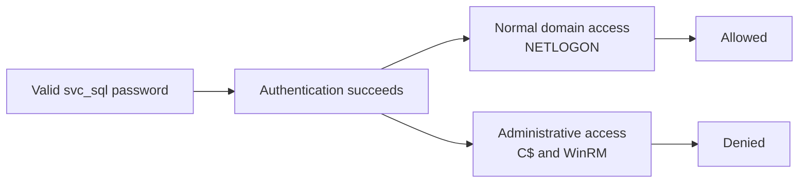

# 09 - Authorization Assessment

## Status

**Completed.**

## Objective

Determine what the recovered `svc_sql` identity is permitted to access after successful authentication.

## Starting Position

The `svc_sql` password had been recovered offline from a Kerberoast ticket. A
successful Event 4768 proved the password could request a TGT. That proved
authentication only; it did not prove authorization or administrative access.

## Tests and Results

### Active Directory membership

`svc_sql` was enabled and belonged only to `Domain Users`. Its MSSQL-style SPNs
made it Kerberoastable, but SPNs did not grant privilege.

### SMB share discovery

Authenticated SMB enumeration showed `ADMIN$`, `C$`, `IPC$`, `NETLOGON`, and
`SYSVOL`. Seeing a share name does not mean the account can open it.

- Listing `NETLOGON` succeeded. This is expected for ordinary domain users.
- Opening `C$` failed with `NT_STATUS_ACCESS_DENIED`. This proved the account was
  not an administrator on the domain controller.
- The SMB1 workgroup-listing warning after the modern SMB result was not the
  important finding; the authenticated SMB2/3 results above it were valid.

### WinRM authorization

Authentication attempts to Windows 10 reached WinRM, but command execution was
denied. Windows recorded WinRM Operational Event 192 with error 5. Local-group
inspection explained why:

- `LAB\svc_web` was in `Remote Management Users`.
- `svc_sql` was not in that group.
- `svc_sql` was not a local administrator.

## Interpretation

This is the desired least-privilege result. Credential compromise is serious,
but authorization boundaries still limited the immediate impact.

## Telemetry

- AD and Windows Security logons for `svc_sql`
- SMB success and access-denied results in Kali evidence
- WinRM Operational Event 192 authorization failures
- Splunk events on both `AD-DC01` and `WIN10-CLIENT01`

## MITRE ATT&CK

- `T1078` - Valid Accounts
- `T1135` - Network Share Discovery
- `T1021.006` - Windows Remote Management

## Evidence

- `P05_01_svc_sql_smb_share_enumeration.png`
- `P05_02_svc_sql_netlogon_access.png`
- `P05_03_svc_sql_c_share_denied.png`
- `P05_04_svc_sql_winrm_authorization_failure.png`
- `P05_05_svc_sql_splunk_logons.png`
- `P05_06_winrm_group_membership.png`
- `P05_07_winrm_event_192_authorization_failure.png`
