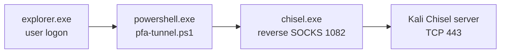

# 10 - Persistence and C2 Simulation

## Status

**Completed and intentionally left active for later detection and SOAR testing.**

## Objective

Simulate what could happen after a valid domain account gains remote access to an internal workstation:

1. Establish a repeatable, user-level persistence mechanism.
2. Recreate the Chisel tunnel whenever that user logs on.
3. Preserve enough endpoint and network telemetry for detection engineering.

This was a controlled lab simulation. It did not use malware, exploit a new vulnerability, or grant the account administrative privileges.

## Starting Position

The attack chain had already reached `WIN10-CLIENT01` through two pivots:

```mermaid
flowchart LR
    Kali["Kali attacker<br/>192.168.111.144"]
    DVWA["Compromised DVWA<br/>10.10.60.10"]
    Socks1080["Chisel SOCKS<br/>127.0.0.1:1080"]
    Win10["WIN10-CLIENT01<br/>LAB&#92;svc_web"]

    Kali -->|"Reverse Chisel session"| DVWA
    DVWA --> Socks1080
    Socks1080 -->|"WinRM TCP 5985"| Win10
```



The domain account `LAB\svc_web` was permitted to use WinRM on the Windows client but was not made a local administrator.

## Telemetry Preparation

Before creating persistence, Windows telemetry was improved so the activity would be observable.

### Process Creation Auditing

Security Event `4688` was enabled for successful and failed process creation. Command-line recording was enabled through:

```text
ProcessCreationIncludeCmdLine_Enabled = 1
```

This allows Event 4688 to record:

- Parent process
- New process
- User
- Process command line
- Integrity level

### PowerShell Script Block Logging

PowerShell Script Block Logging was enabled. This produces Event `4104`, which records PowerShell code that was executed.

### Splunk Universal Forwarder Inputs

The Windows forwarder was configured to collect:

- `WinEventLog://Security`
- `WinEventLog://Microsoft-Windows-PowerShell/Operational`
- `WinEventLog://Microsoft-Windows-WinRM/Operational`

These events were ultimately stored in Splunk index `main`, not `default`. This index mapping matters when building searches.

## Persistence Mechanism

A user-level registry Run key was created for `LAB\svc_web`.

| Item | Value |
|---|---|
| Registry location | `HKCU\Software\Microsoft\Windows\CurrentVersion\Run` |
| Value name | `PFA-Lab-Tunnel` |
| Script | `%LOCALAPPDATA%\PFA-Lab\pfa-tunnel.ps1` |
| Marker | `PFA_PERSISTENCE_C2_01` |
| Chisel binary | `C:\Users\svc_web\Documents\chisel.exe` |
| Reverse SOCKS listener | Kali `127.0.0.1:1082` |

`HKCU` means the persistence applies only to the compromised user. It does not require administrator rights and runs when that user logs on.

The script:

1. Writes a harmless execution marker to a local log.
2. Starts `chisel.exe`.
3. Connects to Kali on TCP `443`.
4. Requests a reverse SOCKS listener on Kali port `1082`.

## Execution Chain

When `svc_web` logged on, Windows followed this process chain:



This chain is important defensively because each transition has evidence:

- `explorer.exe -> powershell.exe`: Event 4688
- PowerShell script contents: Event 4104
- `powershell.exe -> chisel.exe`: Event 4688
- Win10 to Kali TCP 443: OPNsense firewall flow
- New reverse listener `127.0.0.1:1082`: Chisel server log and Kali socket state

## Validation

The following observations proved that persistence executed:

- The registry Run value existed.
- The PowerShell script existed in the user profile.
- Its marker appeared in the execution log.
- A new Chisel process started after logon.
- Kali displayed `127.0.0.1:1082` in a listening state.
- The Chisel server recorded a new reverse SOCKS session.
- Traffic through port `1082` reached AD-DC01 Kerberos TCP `88`.

The older manual pivot on port `1081` remained separate from the persistence-generated listener on `1082`.

## Splunk Evidence

Splunk recorded:

### Event 4688: PowerShell Started

Parent:

```text
explorer.exe
```

Child:

```text
powershell.exe -NoProfile -ExecutionPolicy Bypass -File ...\pfa-tunnel.ps1
```

### Event 4104: Persistence Script

The PowerShell Operational log contained:

- Marker `PFA_PERSISTENCE_C2_01`
- Script path
- Chisel path
- Kali destination
- Reverse SOCKS argument

### Event 4688: Chisel Started

The command line showed Chisel connecting to the controlled Kali listener and requesting reverse SOCKS port `1082`.

## Network Evidence

OPNsense recorded traffic from:

```text
10.10.30.20 -> 192.168.111.144:443
```

The firewall logs showed the internal pass decision and WAN NAT flow. This proved the endpoint established an outbound channel even though the traffic content was encrypted.

## Detection Result

Endpoint and firewall telemetry detected the behavior, but the active Suricata rules did not produce a Chisel-specific alert.

This is tracked in [[Detection Gap Register]] as an encrypted-tunnel detection gap. Detection should therefore combine:

- Registry Run-key creation
- PowerShell script execution
- A binary launched from a user-writable directory
- Long-lived outbound TCP 443
- Reverse SOCKS behavior
- An unusual destination

## Security Meaning

This phase demonstrates that:

```text
Valid account + remote management access
does not automatically mean administrator access,
but it can still enable durable user-level access.
```

It also demonstrates why endpoint telemetry and network telemetry must be correlated. The firewall sees a connection, while Windows explains which process created it.

## MITRE ATT&CK

- `T1547.001`: Registry Run Keys / Startup Folder
- `T1059.001`: PowerShell
- `T1105`: Ingress Tool Transfer
- `T1572`: Protocol Tunneling
- `T1071.001`: Web Protocols

## Automated Attack Replay Validation

PB05 was successfully converted into a controlled attack-only replay on
2026-09-09. The runner is stored in:

```text
10 - Automation\Purple-Team-Attack-Replay
```

Validated execution:

| Field | Result |
|---|---|
| Run ID | `PTR-20260909T142601Z-12fae5e9` |
| Scenario | `PB05-PersistenceC2` |
| Result | `Passed=True`, exit code `0` |
| Attack boundary | `PB05_STATE_ESTABLISHED` |
| Monitoring started | `False` |
| Response started | `False` |
| Windows Chisel PID | `1420` |
| Reverse SOCKS | Kali `127.0.0.1:1082`, verified |
| Script SHA-256 | `0BB9E99328D977D3C390B69B01AEEC8C183775580728BBA949B809D341873F23` |
| Evidence | `10 - Automation\Purple-Team-Attack-Replay\evidence\PTR-20260909T142601Z-12fae5e9\events.jsonl` |

The automated path is:

```text
Windows controller
  -> Kali
  -> compromised DVWA Chisel reverse SOCKS 1080
  -> temporary Kali loopback relay
  -> pypsrp NTLM session using Microsoft.PowerShell
  -> WIN10-CLIENT01 as LAB\svc_web
  -> Run value, persistence script and Chisel callback
  -> reverse SOCKS 1082 verified on Kali
```

The replay starts only OPNsense, DVWA, Kali, Active Directory and Windows 10.
Splunk and Shuffle are explicit attack-only exclusions. It authenticates to the
existing DVWA foothold, validates the preserved Chisel hashes, creates the exact
PB05 user-level persistence state and stops before detection or response.

`LAB\svc_web` is a member of `Remote Management Users`, not a local
administrator. The runner therefore targets the `Microsoft.PowerShell` PSRP
configuration rather than the generic WinRS command shell. Process verification
uses the PID returned by the hash-verified persistence script instead of a
privileged `Win32_Process` CIM query. The successful PSRP runspace is
disconnected for the configured 7,200-second WinRM idle window so the callback
survives the controller connection; the HKCU Run value remains the durable
persistence mechanism.

The final evidence log contains `pb05_live_replay_completed` followed by
`run_completed`, with `completed_marker=true`, `exit_code=0`, and both monitoring
and response recorded as not started.

## Safety and Cleanup State

The persistence is intentionally still active for later detection and SOAR-response testing. Avoid repeated `svc_web` logons because each logon may create another Chisel client.

Final cleanup must remove:

- The `PFA-Lab-Tunnel` Run value
- The `PFA-Lab` script and execution log
- The lab Chisel binary
- Temporary firewall rules
- Remaining Chisel processes and listeners

Do not perform that cleanup until the defensive validation and response playbook are complete.
