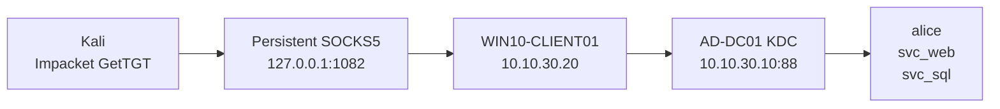
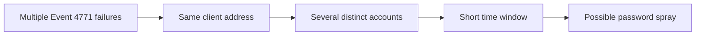

# 11 - Controlled Password Spraying

## Status

**Completed as a supplemental validation at the attack, telemetry and manual
detection-search levels. Final scheduled-alert state and triggered-alert
evidence still require a short audit before the report freeze.**

## Objective

Demonstrate the difference between:

- Offline password cracking, where candidates are tested against captured data on Kali.
- Password spraying, where one password candidate is submitted to several domain identities.

The purpose was to generate realistic Kerberos authentication evidence while keeping the activity tightly scoped and non-destructive.

## What Password Spraying Means

A traditional brute-force attack tries many passwords against one account. Password spraying reverses that pattern:

```text
One password candidate -> several accounts
```

This can reduce the number of failures per account and may avoid poorly designed lockout controls. In this lab, only one attempt was permitted for each of three authorized accounts.

## Safety Preflight

AD-DC01 reported:

| Setting | Observed value |
|---|---|
| Lockout threshold | `0` |
| Observation window | `30 minutes` |
| Lockout duration | `30 minutes` |

`LockoutThreshold = 0` means the domain did not automatically lock accounts after failed attempts. This is unsafe for production but prevented an accidental lab lockout.

The following accounts were checked before testing:

| Account | Enabled | Locked | Bad logons |
|---|---:|---:|---:|
| `alice` | Yes | No | 0 |
| `svc_web` | Yes | No | 0 |
| `svc_sql` | Yes | No | 0 |

The persistent Chisel channel was also validated:

- Kali listener `127.0.0.1:1082` was active.
- AD-DC01 Kerberos TCP `88` was reachable through it.

## Attack Path



Because the Kerberos requests exited through the Windows pivot, AD-DC01 observed the client as:

```text
::ffff:10.10.30.20
```

The `::ffff:` prefix is an IPv4-mapped IPv6 representation. The effective IPv4 source was `10.10.30.20`.

## Tool: Impacket GetTGT

`impacket-getTGT` sends a Kerberos Authentication Service request to the domain controller.

For a valid username and password:

1. The KDC validates pre-authentication.
2. It issues a Ticket Granting Ticket.
3. Impacket saves that ticket in a `.ccache` file.

For an invalid password:

1. The KDC rejects the encrypted pre-authentication data.
2. Impacket displays `KDC_ERR_PREAUTH_FAILED`.
3. No usable ticket cache is produced.

The tool is not a dedicated password-spraying framework. It was deliberately invoked once for each approved identity so the number of attempts remained explicit and controlled.

## Accounts Tested

The same password candidate was submitted once to:

1. `alice`
2. `svc_web`
3. `svc_sql`

No password is stored in this vault.

## Results

| Account | Result | Meaning |
|---|---|---|
| `alice` | TGT saved successfully | The candidate matched Alice's password |
| `svc_web` | `KDC_ERR_PREAUTH_FAILED` | The candidate did not match |
| `svc_sql` | `KDC_ERR_PREAUTH_FAILED` | The candidate did not match |

This outcome demonstrates a successful spray pattern: the same candidate was accepted for one identity and rejected for two others.

It does **not** prove privilege escalation. It only proves that Alice's credential was valid.

## Kerberos Events

### Event 4768

Event `4768` represents a Kerberos TGT request.

Splunk displayed two Alice-related 4768 records from `10.10.30.20`. Kerberos exchanges may involve an initial request and a subsequent pre-authenticated request. The result-code field should be inspected to distinguish the sequence conclusively.

Fields of interest:

- Account name
- Client address
- Result code
- Pre-authentication type
- Ticket encryption type

The observed ticket encryption type was:

```text
0x12 = AES-256
```

### Event 4771

Event `4771` records Kerberos pre-authentication failure, commonly including:

```text
Failure code 0x18 = invalid pre-authentication information
```

The two failed attempts did not appear in Splunk during the initial test.
After failure auditing was enabled, the controlled rerun produced two Event
`4771` records in Splunk:

| Account | Client address | Failure code | Pre-authentication type |
|---|---|---|---|
| `svc_web` | `::ffff:10.10.30.20` | `0x18` | `2` |
| `svc_sql` | `::ffff:10.10.30.20` | `0x18` | `2` |

The normalized D03 search returned both records with client IP
`10.10.30.20`. This proves the source telemetry and detection logic.

## Detection Gap and Remediation

The domain's `Kerberos Authentication Service` audit subcategory was configured for:

```text
Success only
```

Therefore:

- Successful Alice authentication produced visible 4768 events.
- Failed `svc_web` and `svc_sql` attempts did not produce the expected 4771 evidence.

This was not a Splunk search failure. The source system was not auditing
Kerberos failures.

The gap is tracked as:

```text
DG-08: Kerberos authentication failure auditing disabled
```

The remediation was subsequently completed:

1. `Kerberos Authentication Service` auditing was set to `Success and
   Failure` and verified with `auditpol`.
2. The two failed service-account attempts were repeated once each.
3. Splunk received both Event `4771` records with failure code `0x18`.
4. The D03 manual detection search returned both failures after normalizing the
   IPv4-mapped client address.
5. A screenshot records D03 as an enabled scheduled alert with a
   `Number of Results > 0` trigger and the Triggered Alerts action.

The last screenshot is historical configuration evidence dated 27 July 2026.
Because later alert-audit notes described D03 as disabled, the current enabled
state and an actual scheduled-trigger record must be checked once before final
reporting. This does not reopen the Event `4771` telemetry gap.

## Detection Logic

A useful spray detection should group authentication failures by:

- Source address
- Short time window
- Number of distinct accounts
- Shared failure code

Conceptually:



One successful 4768 near several 4771 failures from the same client strengthens the finding because it may indicate that one sprayed credential was valid.

## Difference from Offline Cracking

| Offline cracking | Password spraying |
|---|---|
| Performed against captured ticket material | Performed against the live KDC |
| Does not create repeated AD failures | Can create 4771 events |
| Cannot directly lock an AD account | Can affect lockout counters |
| John or Hashcat | Impacket GetTGT in this controlled test |
| Validates candidate against a local hash | Requests authentication from AD |

## Defensive Lessons

- Enable success and failure Kerberos auditing.
- Configure a sensible account-lockout policy.
- Detect one source failing against multiple identities.
- Monitor service accounts and normal users separately.
- Correlate 4771 failures with a nearby 4768 success.
- Alert when authentication originates from an unusual workstation.
- Do not use predictable or reused passwords.

## Sensitive Artifact

Successful GetTGT execution created:

```text
alice.ccache
```

A `.ccache` contains live Kerberos credential material. It must:

- Never be committed to GitHub.
- Never be attached to the report.
- Never appear in screenshots.
- Be deleted when no longer required.

The vault `.gitignore` already excludes `*.ccache`.

## Evidence

- `P07_01_password_spray_preflight.png`
- `P07_02_controlled_password_spray_kali.png`
- `P07_03_authentication_failure_audit_gap.png`
- `P07_04_kerberos_failure_auditing_enabled.png`
- `P07_05_kerberos_password_spray_events.png`
- `D03_01_kerberos_failure_detection_search.png`
- `D03_02_kerberos_failure_alert_configuration.png`

Still desirable before the report freeze:

- a current D03 saved-search status export;
- a D03 triggered-alert record or scheduler-history result;
- a post-test account-lockout check, if it was not already preserved elsewhere.

## MITRE ATT&CK

- `T1110.003`: Password Spraying
- `T1078`: Valid Accounts

## Current Conclusion

The controlled action proved one candidate valid for Alice and two candidates
invalid for the service accounts. The initial defensive gap was then corrected:
failure auditing was enabled, Event `4771` reached Splunk, and D03 returned the
two expected failures. The test remains supplemental to the main compromise
chain, and only the current scheduled-alert/trigger state needs final auditing.
