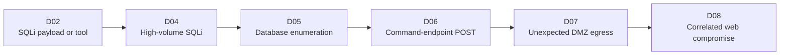

# Phase 2 Web Exploitation Detections

## Outcome

Phase 2 detection engineering is complete. Six scheduled Splunk alerts were
developed in attack-chain order and validated against both historical attack
telemetry and fresh controlled replay traffic. The final validation repeated
the original authenticated curl command-injection and reverse-shell workflow.

No passwords, cookies, CSRF tokens, password hashes, or recovered data are
stored in this note.



## Detection Summary

| ID | Detection | Severity | Schedule | Search window | Status |
|---|---|---:|---|---|---|
| `D02` | Possible SQL Injection Against DVWA | High | Every 5 minutes | Last 5 minutes | Validated |
| `D04` | High-Volume SQL Injection Probing Against DVWA | High | Every 5 minutes | Last 5 minutes | Validated |
| `D05` | SQL Database Enumeration and Extraction Against DVWA | High | Every 5 minutes | Last 5 minutes | Validated |
| `D06` | Suspicious POST to DVWA Command Execution Endpoint | Medium | Every 5 minutes | Last 5 minutes | Validated |
| `D07` | Unexpected Outbound TCP Connection from DMZ to WAN | Medium | Every 5 minutes | Last 5 minutes | Validated |
| `D08` | Correlated DVWA Command Execution and DMZ Callback | Critical | Every 5 minutes | Last 10 minutes | Validated |

All alerts use `Number of Results > 0`, digest mode, and the **Add to
Triggered Alerts** action. D08 uses a ten-minute search window so both signals
remain available across scheduler boundaries; its SPL still requires a
maximum five-minute callback delay.

## D02 - Possible SQL Injection Against DVWA

### Purpose

Detect a recognizable SQL injection payload or a SQLmap user agent against the
DVWA SQL injection endpoint. The rule evaluates every source address and does
not depend on a known attacker IP.

### Data Source

`index=linux host="dmz-dvwa" sourcetype="docker:json"`

### SPL

```spl
index=linux host="dmz-dvwa" sourcetype="docker:json" "/vulnerabilities/sqli/"
| spath path=log output=access_line
| rex field=access_line "^(?<src_ip>\d{1,3}(?:\.\d{1,3}){3})\s+\S+\s+\S+\s+\[[^\]]+\]\s+\"(?<http_method>\S+)\s+(?<uri>\S+)\s+HTTP/[^\"]+\"\s+(?<status>\d{3})\s+(?<bytes>\d+)\s+\"[^\"]*\"\s+\"(?<user_agent>[^\"]*)\""
| eval decoded_uri=urldecode(uri), ua=lower(user_agent)
| eval sqlmap_ua=if(like(ua,"%sqlmap%"),1,0), sqli_payload=if(match(decoded_uri,"(?i)(union\s+(all\s+)?select|information_schema|(?:sleep|benchmark|updatexml|extractvalue)\s*\(|(?:\x27|%27)\s*(?:or|and)\s+)"),1,0)
| where sqlmap_ua=1 OR sqli_payload=1
| eval detection_reason=case(sqlmap_ua=1 AND sqli_payload=1,"SQLmap user agent and SQLi payload",sqlmap_ua=1,"SQLmap user agent",sqli_payload=1,"SQLi payload pattern")
| stats count min(_time) as first_seen max(_time) as last_seen values(http_method) as methods values(status) as statuses values(detection_reason) as reasons latest(uri) as sample_uri by src_ip user_agent
| convert ctime(first_seen) ctime(last_seen)
| table first_seen last_seen src_ip user_agent count methods statuses reasons sample_uri
```

### Validation

- Historical telemetry matched the SQLmap campaign and a manual SQLi request.
- Fresh labeled SQLi traffic triggered D02.
- A `302` fresh test demonstrated attempt detection, not exploit success.
- Historical `200` events demonstrated matching against the real attack.

### MITRE ATT&CK

- `T1190` - Exploit Public-Facing Application

### Gap

The access log exposes GET URI payloads but not POST bodies. Heavy obfuscation,
alternate encodings, or a changed user agent may evade individual indicators.

## D04 - High-Volume SQL Injection Probing Against DVWA

### Purpose

Detect automated SQL injection campaigns based on request volume or payload
diversity per source during a five-minute window.

### SPL

```spl
index=linux host="dmz-dvwa" sourcetype="docker:json" "/vulnerabilities/sqli/"
| spath path=log output=access_line
| rex field=access_line "^(?<src_ip>\d{1,3}(?:\.\d{1,3}){3})\s+\S+\s+\S+\s+\[[^\]]+\]\s+\"(?<http_method>\S+)\s+(?<uri>\S+)\s+HTTP/[^\"]+\"\s+(?<status>\d{3})\s+(?<bytes>\d+)\s+\"[^\"]*\"\s+\"(?<user_agent>[^\"]*)\""
| eval decoded_uri=urldecode(uri), ua=lower(user_agent)
| eval is_sqli=if(like(ua,"%sqlmap%") OR match(decoded_uri,"(?i)(union\s+(all\s+)?select|information_schema|(?:sleep|benchmark|updatexml|extractvalue)\s*\(|(?:\x27|%27)\s*(?:or|and)\s+)"),1,0)
| where is_sqli=1
| bin _time span=5m
| stats count as request_count dc(uri) as distinct_payloads values(user_agent) as user_agents values(status) as statuses latest(uri) as sample_uri by _time src_ip
| where request_count >= 20 OR distinct_payloads >= 10
| convert ctime(_time)
| table _time src_ip request_count distinct_payloads user_agents statuses sample_uri
| sort - request_count
```

### Threshold Basis

- Historical SQLmap peak: 144 requests and 143 distinct payloads in five minutes.
- Manual requests: one request and one payload.
- Live validation: 25 requests and 25 distinct payloads.

### MITRE ATT&CK

- `T1190` - Exploit Public-Facing Application

### Gap

The threshold is calibrated to this lab. Production deployment requires a
baseline per application, source type, scanner, and maintenance window.

## D05 - SQL Database Enumeration and Extraction Against DVWA

### Purpose

Identify SQL payloads that indicate database-name discovery, schema metadata
enumeration, table or column enumeration, application-data targeting, or
concatenated extraction.

### SPL

```spl
index=linux host="dmz-dvwa" sourcetype="docker:json" "/vulnerabilities/sqli/"
| spath path=log output=access_line
| rex field=access_line "^(?<src_ip>\d{1,3}(?:\.\d{1,3}){3})\s+\S+\s+\S+\s+\[[^\]]+\]\s+\"(?<http_method>\S+)\s+(?<uri>\S+)\s+HTTP/[^\"]+\"\s+(?<status>\d{3})\s+(?<bytes>\d+)\s+\"[^\"]*\"\s+\"(?<user_agent>[^\"]*)\""
| eval decoded_uri=urldecode(uri)
| eval enumeration_type=case(
    match(decoded_uri,"(?i)information_schema"),"Schema metadata enumeration",
    match(decoded_uri,"(?i)database\s*\("),"Database-name discovery",
    match(decoded_uri,"(?i)(table_name|column_name)"),"Table or column enumeration",
    match(decoded_uri,"(?i)(users|guestbook).*(user|password)"),"DVWA data targeting",
    match(decoded_uri,"(?i)(group_concat|concat\s*\()"),"Concatenated data extraction"
  )
| where isnotnull(enumeration_type)
| stats count as indicator_requests dc(decoded_uri) as distinct_payloads values(enumeration_type) as enumeration_types values(status) as statuses min(_time) as first_seen max(_time) as last_seen by src_ip user_agent
| convert ctime(first_seen) ctime(last_seen)
| table first_seen last_seen src_ip user_agent indicator_requests distinct_payloads enumeration_types statuses
| sort - indicator_requests
```

### Validation

- Historical attack: 22 distinct payloads across four enumeration categories.
- Live replay: 25 database-name discovery payloads, all recognized.
- Full payloads were excluded from final alert output and screenshots to avoid
  storing encoded extracted values.

### MITRE ATT&CK

- `T1190` - Exploit Public-Facing Application
- `T1213` - Data from Information Repositories

### Gap

`case()` returns the first matching category. One payload may contain multiple
indicators while the output records only the highest-priority matching label.

## D06 - Suspicious POST to DVWA Command Execution Endpoint

### Purpose

Detect a POST request submitted to DVWA's OS-command execution endpoint. The
title intentionally describes the visible behavior rather than claiming that
the hidden POST body contained a shell command.

### SPL

```spl
index=linux host="dmz-dvwa" sourcetype="docker:json" "/vulnerabilities/exec/"
| spath path=log output=access_line
| rex field=access_line "^(?<src_ip>\d{1,3}(?:\.\d{1,3}){3})\s+\S+\s+\S+\s+\[[^\]]+\]\s+\"(?<http_method>\S+)\s+(?<uri>\S+)\s+HTTP/[^\"]+\"\s+(?<status>\d{3})\s+(?<bytes>\d+)\s+\"[^\"]*\"\s+\"(?<user_agent>[^\"]*)\""
| where http_method="POST" AND like(uri,"/vulnerabilities/exec/%")
| eval client_type=if(like(lower(user_agent),"%curl%"),"Command-line HTTP client","Web browser or other client")
| stats count as post_requests values(status) as statuses values(bytes) as response_sizes min(_time) as first_seen max(_time) as last_seen by src_ip user_agent client_type
| convert ctime(first_seen) ctime(last_seen)
| table first_seen last_seen src_ip user_agent client_type post_requests statuses response_sizes
| sort - post_requests
```

### Validation

- Historical data contained seven curl POSTs and two Firefox POSTs.
- The real replay used an authenticated curl request, returned HTTP `200`,
  and executed `id` as `www-data`.
- The final reverse-shell replay produced two authenticated curl POST results
  with response sizes 4871 and 4925 bytes.

### MITRE ATT&CK

- `T1190` - Exploit Public-Facing Application
- `T1059.004` - Command and Scripting Interpreter: Unix Shell

### Gap

Apache access logs do not contain the POST body. D06 cannot independently
distinguish a benign ping submission from injected command execution.

## D07 - Unexpected Outbound TCP Connection from DMZ to WAN

### Purpose

Detect a DMZ system initiating an allowed TCP connection to a destination
outside the trusted lab zones. The rule does not hardcode the attacker's IP or
callback port; those values are investigation output.

### Trusted Zones

- Internal: `10.10.30.0/24`
- Security: `10.10.50.0/24`
- DMZ: `10.10.60.0/24`
- Transit: `10.10.70.0/24`

### SPL

```spl
index=opnsense source="udp:5514" sourcetype="syslog" "filterlog"
| rex field=_raw ",(?<action>pass|block),(?<direction>in|out),4,(?:[^,]*,){7}(?<protocol>tcp|udp),(?<packet_length>\d+),(?<src_ip>\d{1,3}(?:\.\d{1,3}){3}),(?<dst_ip>\d{1,3}(?:\.\d{1,3}){3}),(?<src_port>\d+),(?<dst_port>\d+),[^,]*,(?<tcp_flags>[^,]*)"
| eval src_zone=case(
    cidrmatch("10.10.30.0/24",src_ip),"Internal",
    cidrmatch("10.10.50.0/24",src_ip),"Security",
    cidrmatch("10.10.60.0/24",src_ip),"DMZ",
    cidrmatch("10.10.70.0/24",src_ip),"Transit",
    true(),"External/WAN"
  )
| eval dst_zone=case(
    cidrmatch("10.10.30.0/24",dst_ip),"Internal",
    cidrmatch("10.10.50.0/24",dst_ip),"Security",
    cidrmatch("10.10.60.0/24",dst_ip),"DMZ",
    cidrmatch("10.10.70.0/24",dst_ip),"Transit",
    true(),"External/WAN"
  )
| where action="pass" AND src_zone="DMZ" AND dst_zone="External/WAN" AND protocol="tcp" AND tcp_flags="S"
| eval detection_reason="DMZ system initiated a TCP connection to an external or WAN destination"
| stats count as connection_attempts min(_time) as first_seen max(_time) as last_seen values(src_port) as source_ports by src_ip src_zone dst_ip dst_zone dst_port protocol detection_reason
| convert ctime(first_seen) ctime(last_seen)
| table first_seen last_seen src_ip src_zone dst_ip dst_zone dst_port protocol connection_attempts source_ports detection_reason
| sort - connection_attempts
```

### Validation

- Historical baseline exposed three DMZ-to-WAN TCP SYN events.
- The real replay generated a new connection from `10.10.60.10` to the
  dynamically observed external peer on TCP 443.

### MITRE ATT&CK

- `T1095` - Non-Application Layer Protocol

### Gap

The firewall event proves connection initiation, not reverse-shell content.
The rule also requires an approved DMZ-egress allowlist before production use.

## D08 - Correlated DVWA Command Execution and DMZ Callback

### Purpose

Correlate an external peer's POST to the command-execution endpoint with a DMZ
TCP connection back to that same peer within five minutes. Neither the peer IP
nor destination port is hardcoded.

### SPL

```spl
(
  index=linux host="dmz-dvwa" sourcetype="docker:json" "/vulnerabilities/exec/"
)
OR
(
  index=opnsense source="udp:5514" sourcetype="syslog" "filterlog"
)
| spath path=log output=access_line
| rex field=access_line "^(?<web_src_ip>\d{1,3}(?:\.\d{1,3}){3})\s+\S+\s+\S+\s+\[[^\]]+\]\s+\"(?<web_method>\S+)\s+(?<web_uri>\S+)\s+HTTP/[^\"]+\"\s+(?<web_status>\d{3})\s+(?<web_bytes>\d+)\s+\"[^\"]*\"\s+\"(?<web_user_agent>[^\"]*)\""
| rex field=_raw ",(?<fw_action>pass|block),(?<fw_direction>in|out),4,(?:[^,]*,){7}(?<net_protocol>tcp|udp),(?<packet_length>\d+),(?<net_src_ip>\d{1,3}(?:\.\d{1,3}){3}),(?<net_dst_ip>\d{1,3}(?:\.\d{1,3}){3}),(?<net_src_port>\d+),(?<net_dst_port>\d+),[^,]*,(?<tcp_flags>[^,]*)"
| eval net_src_zone=case(
    isnull(net_src_ip),null(),
    cidrmatch("10.10.30.0/24",net_src_ip),"Internal",
    cidrmatch("10.10.50.0/24",net_src_ip),"Security",
    cidrmatch("10.10.60.0/24",net_src_ip),"DMZ",
    cidrmatch("10.10.70.0/24",net_src_ip),"Transit",
    true(),"External/WAN"
  )
| eval net_dst_zone=case(
    isnull(net_dst_ip),null(),
    cidrmatch("10.10.30.0/24",net_dst_ip),"Internal",
    cidrmatch("10.10.50.0/24",net_dst_ip),"Security",
    cidrmatch("10.10.60.0/24",net_dst_ip),"DMZ",
    cidrmatch("10.10.70.0/24",net_dst_ip),"Transit",
    true(),"External/WAN"
  )
| eval signal=case(
    index="linux" AND web_method="POST" AND like(web_uri,"/vulnerabilities/exec/%"),"command_endpoint_post",
    index="opnsense" AND fw_action="pass" AND net_protocol="tcp" AND tcp_flags="S" AND net_src_zone="DMZ" AND net_dst_zone="External/WAN","dmz_to_wan_tcp_syn"
  )
| eval external_peer=case(signal="command_endpoint_post",web_src_ip,signal="dmz_to_wan_tcp_syn",net_dst_ip)
| where isnotnull(signal) AND isnotnull(external_peer)
| eval web_time_candidate=if(signal="command_endpoint_post",_time,null())
| eval web_endpoint_candidate=if(signal="command_endpoint_post",web_uri,null())
| eval web_status_candidate=if(signal="command_endpoint_post",web_status,null())
| eval web_user_agent_candidate=if(signal="command_endpoint_post",web_user_agent,null())
| sort 0 external_peer _time
| streamstats current=f last(web_time_candidate) as previous_web_time last(web_endpoint_candidate) as previous_web_endpoint last(web_status_candidate) as previous_web_status last(web_user_agent_candidate) as previous_web_user_agent by external_peer
| where signal="dmz_to_wan_tcp_syn" AND isnotnull(previous_web_time)
| eval callback_delay_seconds=_time-previous_web_time
| where callback_delay_seconds>=0 AND callback_delay_seconds<=300
| eval web_event_time=strftime(previous_web_time,"%Y-%m-%d %H:%M:%S")
| eval callback_time=strftime(_time,"%Y-%m-%d %H:%M:%S")
| eval detection_reason="DMZ initiated an external TCP connection within five minutes of a command-endpoint POST from the same external peer"
| table web_event_time callback_time callback_delay_seconds external_peer previous_web_endpoint previous_web_status previous_web_user_agent net_src_ip net_dst_ip net_dst_port net_protocol detection_reason
| sort 0 callback_time
```

### Validation

- Historical data produced two correlations with four- and five-second delays.
- The real authenticated curl replay produced:
  - Web POST at `2026-07-31 20:11:11`
  - DMZ callback at `2026-07-31 20:11:15`
  - Four-second delay
  - HTTP `200`
  - Curl user agent
  - DMZ source `10.10.60.10`
  - TCP destination port 443
- Splunk generated a Critical D08 triggered alert.

### MITRE ATT&CK

- `T1190` - Exploit Public-Facing Application
- `T1059.004` - Command and Scripting Interpreter: Unix Shell
- `T1095` - Non-Application Layer Protocol

### Gap

The correlation assumes that the web source IP and callback destination remain
comparable. Reverse proxies, carrier NAT, delayed callbacks, missing firewall
logs, or callbacks after five minutes may prevent correlation.

## Validation Evidence

```text
P2_D02_sql_injection_validation_results.png
P2_D04_high_volume_sqli_historical_validation.png
P2_D04_high_volume_sqli_alert_overview.png
P2_D04_high_volume_sqli_live_validation.png
P2_D05_database_enumeration_historical_validation.png
P2_D05_database_enumeration_alert_overview.png
P2_D05_database_enumeration_live_validation.png
P2_D06_command_endpoint_post_historical_validation.png
P2_D06_command_endpoint_alert_overview.png
P2_D06_real_command_injection_curl_proof.png
P2_D06_authenticated_command_injection_live_validation.png
P2_D07_unexpected_dmz_egress_historical_validation.png
P2_D07_unexpected_dmz_egress_alert_overview.png
P2_D07_real_dmz_callback_live_validation.png
P2_D08_correlated_web_compromise_historical_validation.png
P2_D08_correlated_web_compromise_alert_overview.png
P2_D08_real_reverse_shell_curl_validation.png
P2_D08_real_web_compromise_correlation_live_validation.png
P2_phase2_sqli_alerts_live_validation_summary.png
P2_phase2_command_compromise_alerts_live_summary.png
```

## Analyst Interpretation

- A `302` response can validate that an attempted attack reached logging and
  alerting, but it does not prove exploitation.
- Historical HTTP `200` events showed the real SQLmap activity.
- The final authenticated HTTP `200` curl replay and interactive `www-data`
  reverse shell proved actual command execution.
- D08 is the strongest Phase 2 result because it combines independent web and
  network telemetry instead of relying on one payload or known attacker IP.
