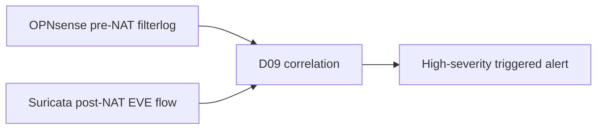
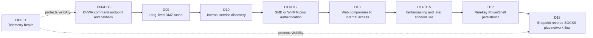

# Phase 3 DMZ Pivot and Internal Access Detections

## Current Outcome

Suricata standalone EVE flow telemetry was enabled locally on OPNsense and
forwarded to Splunk through the existing UDP 5514 syslog path. Phase 3 was
completed with behavior-based network, endpoint, web, and identity detections
covering the original attack chain from the compromised DVWA host through
internal access, Kerberoasting, valid-account use, persistence, and reverse
SOCKS tunneling. D09 through D18 (excluding the intentionally unused D16 ID)
were live-validated. OPS01 was also created to monitor critical telemetry
health. No passwords, cookies, CSRF tokens, Kerberos ticket material, hashes,
or recovered secrets are stored here.



## Telemetry Improvement T01/T02

- OPNsense: `26.1.6_2`
- Suricata: `8.0.4 RELEASE`
- Persistent override: `/usr/local/etc/suricata/conf.d/10-eve-flow.yaml`
- Added standalone `flow` events to local EVE and the existing syslog EVE
  output while preserving alert, anomaly, drop, SSH, stats, and syslog outputs.
- Configuration validation: `suricata -T` returned exit code `0` before each
  restart.
- Splunk destination: `index=opnsense source=udp:5514 sourcetype=syslog`
- HTTP EVE logging was intentionally not enabled because HTTP records may
  retain authentication cookies, conflicting with project secret hygiene.

### Evidence

```text
P3-T01-Suricata-EVE-Flow-Telemetry-Validated.png
P3-T02-Splunk-Suricata-Flow-Ingestion-Validated.png
```

## D09 - Correlated Long-Lived Bidirectional TCP 443 Tunnel from DMZ

### Purpose

Detect allowed DMZ egress whose pre-NAT firewall start correlates with a
post-NAT Suricata TCP 443 flow lasting at least 120 seconds with meaningful
bidirectional traffic and WebSocket or very-long-lived behavior. The rule
does not hardcode the attacker address; the external peer is discovered from
both telemetry sources.

### Data Sources

- OPNsense `filterlog`: pre-NAT DMZ identity and initial allowed SYN.
- Suricata EVE `flow`: post-NAT duration, packets, bytes, application protocol,
  flow state, and close reason.

### Production SPL

```spl
index=opnsense source="udp:5514" sourcetype="syslog" "\"event_type\":\"flow\""
| rex field=_raw "(?<eve_json>\{.*\})"
| spath input=eve_json
| search event_type="flow"
| eval duration_seconds=tonumber('flow.age'),
       packets_out=tonumber('flow.pkts_toserver'),
       packets_in=tonumber('flow.pkts_toclient'),
       bytes_out=tonumber('flow.bytes_toserver'),
       bytes_in=tonumber('flow.bytes_toclient'),
       external_port=tonumber(dest_port)
| where in_iface="em0"
    AND upper(proto)="TCP"
    AND external_port=443
    AND duration_seconds>=120
    AND packets_out>0
    AND packets_in>0
    AND bytes_out>=1000
    AND bytes_in>=1000
    AND (lower(app_proto)="websocket" OR duration_seconds>=300)
| eval external_peer=dest_ip,
       wan_src_ip=src_ip,
       wan_src_port=src_port,
       flow_start_epoch=strptime('flow.start',"%Y-%m-%dT%H:%M:%S.%6N%z"),
       flow_end_epoch=strptime('flow.end',"%Y-%m-%dT%H:%M:%S.%6N%z"),
       flow_state='flow.state',
       flow_reason='flow.reason'
| join type=inner max=0 external_peer external_port [
    search earliest=-24h@h latest=now index=opnsense source="udp:5514" sourcetype="syslog" "filterlog"
    | rex field=_raw ",(?<action>pass|block),(?<direction>in|out),4,(?:[^,]*,){7}(?<protocol>tcp|udp),(?<packet_length>\d+),(?<src_ip>\d{1,3}(?:\.\d{1,3}){3}),(?<dst_ip>\d{1,3}(?:\.\d{1,3}){3}),(?<src_port>\d+),(?<dst_port>\d+),[^,]*,(?<tcp_flags>[^,]*)"
    | eval src_zone=if(cidrmatch("10.10.60.0/24",src_ip),"DMZ","Other")
    | eval dst_zone=case(
        cidrmatch("10.10.30.0/24",dst_ip),"Internal",
        cidrmatch("10.10.50.0/24",dst_ip),"Security",
        cidrmatch("10.10.60.0/24",dst_ip),"DMZ",
        cidrmatch("10.10.70.0/24",dst_ip),"Transit",
        true(),"External/WAN"
      )
    | where action="pass"
        AND src_zone="DMZ"
        AND dst_zone="External/WAN"
        AND protocol="tcp"
        AND tonumber(dst_port)=443
        AND tcp_flags="S"
    | eval external_peer=dst_ip,
           external_port=tonumber(dst_port),
           firewall_start_epoch=_time,
           dmz_src_ip=src_ip,
           dmz_src_port=src_port
    | fields external_peer external_port firewall_start_epoch dmz_src_ip dmz_src_port
  ]
| eval start_delta_seconds=round(abs(flow_start_epoch-firewall_start_epoch),3)
| where start_delta_seconds<=10
| eval flow_start_time=strftime(flow_start_epoch,"%Y-%m-%d %H:%M:%S"),
       flow_end_time=strftime(flow_end_epoch,"%Y-%m-%d %H:%M:%S")
| eval detection_reason=case(
    lower(app_proto)="websocket","DMZ egress correlated with a long-lived bidirectional WebSocket session over TCP 443",
    duration_seconds>=300,"DMZ egress correlated with a long-lived bidirectional TCP 443 session"
  )
| table flow_id flow_start_time flow_end_time dmz_src_ip dmz_src_port wan_src_ip wan_src_port external_peer external_port app_proto duration_seconds packets_out packets_in bytes_out bytes_in start_delta_seconds flow_state flow_reason detection_reason
| sort - duration_seconds
```

### Alert Settings

| Setting | Value |
|---|---|
| Severity | High |
| Schedule | `*/5 * * * *` |
| Main search window | Earliest `-20m`, latest `now` |
| Filterlog correlation history | `-24h@h` to `now` |
| Trigger mode | Per result; number of results greater than zero |
| Suppression | One hour by `flow_id` |
| Action | Add to Triggered Alerts |

### Genuine Replay Result

- Authenticated command injection launched the original DVWA Chisel client.
- Kali ran the original reverse server on TCP 443 and exposed SOCKS5 on
  `127.0.0.1:1080`.
- An unauthenticated request traversed the SOCKS tunnel and reached the Windows
  WinRM service, which correctly returned HTTP `405` for an unsupported GET.
- Correlated flow duration: `417` seconds.
- Application protocol: `websocket` (`http` origin).
- Packets: 161 outbound and 157 inbound.
- Bytes: 17,933 outbound and 17,097 inbound.
- Pre-/post-NAT start delta: `1.157` seconds.
- Final flow state: closed.
- Splunk produced a High-severity, per-result D09 triggered alert.

### MITRE ATT&CK

- `T1572` - Protocol Tunneling

### Detection Gaps

- EVE flow records are emitted when a flow closes or times out, so D09 is not
  an immediate detector for a tunnel that remains active indefinitely.
- The 24-hour filterlog correlation history limits attribution of sessions
  lasting more than 24 hours.
- Long-lived approved WebSocket applications may require a DMZ egress
  allowlist and asset ownership context to reduce false positives.
- Periodic firewall-state or NetFlow/IPFIX active-flow export and endpoint
  process telemetry would improve real-time detection.

### Evidence

```text
P3-D09-Chisel-Suricata-Flow-Observed.png
P3-D09-Firewall-PreNAT-Tunnel-Start-Observed.png
P3-D09-Correlated-Long-Lived-DMZ-Tunnel-Search.png
P3-D09-Alert-Configuration.png
P3-D09-Triggered-Alert-Summary.png
P3-D09-Triggered-Alert-Validated.png
```

## Completed Phase 3 Detection Chain



The searches use zone CIDRs, asset mappings, behavior, entity relationships,
and time correlation. They do not embed the known Kali attacker IP as a rule
condition. Addresses such as the DMZ and internal subnets are documented asset
boundaries, not assumed attacker indicators.

## Final Phase 3 Detection Catalog

| ID | Detection | Primary evidence | Severity | Status |
|---|---|---|---:|---|
| `D09` | Correlated Long-Lived Bidirectional TCP 443 Tunnel from DMZ | OPNsense filterlog + Suricata EVE flow | High | Live-validated |
| `D10` | DMZ-Originated Internal Service Discovery | OPNsense filterlog | Medium | Live-validated |
| `D11` | Allowed DMZ-to-Internal SMB or WinRM Traffic | OPNsense filterlog | High | Live-validated |
| `D12` | Correlated DMZ Remote Management and Internal Authentication | OPNsense + Windows Security | High | Live-validated |
| `D13` | Correlated Web Compromise to Internal Access | DVWA + OPNsense + Windows Security | Critical | Live-validated |
| `D14` | Probable Kerberoasting via RC4 Service Ticket | AD Event 4769 | High | Live-validated |
| `D15` | Kerberoasted Service Account Subsequently Used | AD Events 4769 and 4768 | Critical | Live-validated |
| `D17` | Probable Run-Key Persistence Execution via PowerShell | Windows 4688 + PowerShell 4104 | High | Live-validated |
| `D18` | Endpoint Reverse SOCKS Execution with Long-Lived Callback | Windows 4688 + Suricata EVE flow | Critical | Live-validated |
| `OPS01` | Telemetry Source Silence or Ingestion Delay | Splunk internal telemetry + OPNsense index freshness | High | Live-validated |

`D16` was intentionally not assigned. The optimized design uses correlation
rules for material attack-chain transitions rather than creating a separate
alert for every intermediate event.

## D10 - DMZ-Originated Internal Service Discovery

- **Logic:** Group DMZ-originated TCP SYN attempts into five-minute windows and
  alert when a source reaches at least three internal destinations or four
  distinct internal service ports. Both allowed and blocked attempts retain
  investigative value.
- **Original attack mapping:** The Chisel SOCKS pivot was used to probe internal
  services on AD-DC01, including TCP 53, 88, 389, and 445.
- **Validation:** A controlled four-port proxychains/netcat replay through the
  DVWA tunnel produced OPNsense SYN records and a D10 triggered alert.
- **MITRE:** `T1046` - Network Service Discovery.
- **Production:** Medium, per result, suppress 30 minutes by
  `discovery_key`, search window 10 minutes.

## D11 - Allowed DMZ-to-Internal SMB or WinRM Traffic

- **Logic:** Detect an allowed TCP SYN from the DMZ zone to an internal asset on
  SMB 445 or WinRM 5985. The rule discovers the source and destination from
  telemetry; it does not assume the attacker address.
- **Original attack mapping:** The compromised DVWA path reached
  WIN10-CLIENT01 over WinRM during the pivot.
- **Validation:** Controlled WinRM traffic from the DVWA pivot to the Windows
  client produced the expected result and High-severity alert.
- **MITRE:** `T1021.002` - SMB/Windows Admin Shares and `T1021.006` - Windows
  Remote Management.
- **Production:** High, per result, suppress 30 minutes by `detection_key`,
  search window 10 minutes.

## D12 - Correlated DMZ Remote Management and Internal Authentication

- **Logic:** Correlate an allowed DMZ-to-internal SMB or WinRM SYN with Windows
  Event 4624 or 4625 network logon type 3 from the same source address to the
  mapped target asset within 120 seconds. Machine accounts and empty accounts
  are excluded.
- **Original attack mapping:** The pivot initiated WinRM to WIN10-CLIENT01 and
  authenticated as the lab service account used in the offensive phase.
- **Validation:** The controlled WinRM replay produced matching firewall and
  Windows authentication evidence and a High-severity D12 alert.
- **MITRE:** `T1021.006` - Windows Remote Management and `T1078` - Valid
  Accounts.
- **Production:** High, per result, suppress 30 minutes by `detection_key`,
  search window 10 minutes.

## D13 - Correlated Web Compromise to Internal Access

- **Logic:** Correlate four material stages: a POST to the DVWA command endpoint,
  a DMZ callback to the same external peer, DMZ-to-internal SMB or WinRM
  traffic, and successful Windows network authentication associated with the
  same DMZ pivot and target asset.
- **Original attack mapping:** Authenticated DVWA command injection led to a
  callback, Chisel pivot, WinRM connection, and successful `svc_web` access to
  WIN10-CLIENT01.
- **Validation:** The complete replay triggered the Critical D13 alert and
  preserved the stage timestamps, entities, endpoint, ports, account, and
  authentication result.
- **MITRE:** `T1190` - Exploit Public-Facing Application, `T1572` - Protocol
  Tunneling, `T1021.006` - Windows Remote Management, and `T1078` - Valid
  Accounts.
- **Production:** Critical, per result, suppress 24 hours by `detection_key`,
  correlation window 250 minutes. Scheduler frequency was reduced to
  `5-59/15 * * * *` after the performance baseline showed concurrency skips
  despite healthy search runtimes.

### D13 Scheduler Optimization Validation

- **Pre-change baseline:** 92 scheduler records, 85 successful runs, 7 skipped
  runs, and 0 failed runs. Average runtime was 8.603 seconds, p95 runtime was
  22.903 seconds, and maximum runtime was 38.843 seconds. Average result count
  was 0.047 and maximum result count was 1. The skips were caused by the
  historical-search concurrency limit, not by slow D13 SPL.
- **Change:** Moved D13 to a 15-minute schedule at minutes 5, 20, 35, and 50
  using `5-59/15 * * * *`. The 250-minute correlation window and 24-hour
  result suppression remain unchanged.
- **Post-change validation:** The first two post-change runs both succeeded.
  Results were 2 scheduler records, 2 successful, 0 skipped, 0 failed,
  5.273-second average runtime, and 6.850-second maximum runtime. No scheduler
  reason was returned and suppression flags were `0`. The optimization passed
  its acceptance criteria.
- **Evidence:** `DE-OPT-04-D13-scheduler-baseline.png`,
  `DE-OPT-06-D13-15m-schedule.png`, and
  `DE-OPT-07-D13-post-schedule-validation.png`.

### D13 SOAR Response Integration

D13 is the detection source for `PB01 - D13 Web Compromise to Internal
Access`. Shuffle normalizes the D13 entities, enriches Windows authentication
and OPNsense network evidence, builds a P1 case, emails a human approval gate,
and applies a temporary OPNsense alias block limited to the DMZ pivot reaching
WIN10-CLIENT01 on WinRM TCP 5985. A live test proved the intended block and
manual recovery. PB01 remains a production candidate while its normal rollback
is redesigned to be scheduled independently of verification branches. See
[[Splunk and Shuffle Integration]] for the node-level design, validation
history, failure analysis, and exact pause point.

## D14 - Probable Kerberoasting via RC4 Service Ticket

- **Logic:** Detect successful Event 4769 service-ticket requests using RC4
  (`0x17`) where the requester and SPN service account are non-machine
  accounts. Multiple distinct service accounts increase confidence, but one
  user-managed SPN remains a valid moderate-confidence signal.
- **Original attack mapping:** `svc_web` requested the service ticket for the
  user-managed `svc_sql` MSSQL SPN from WIN10-CLIENT01.
- **Validation:** The replay through the Windows pivot generated a successful
  RC4 Event 4769 and a High-severity D14 alert. Kerberos ticket material was
  redacted and is not stored in Obsidian.
- **MITRE:** `T1558.003` - Kerberoasting.
- **Production:** High, per result, suppress 24 hours by `detection_key`,
  search window 30 minutes.

## D15 - Kerberoasted Service Account Subsequently Used

- **Logic:** Correlate a service account targeted by a successful RC4 Event
  4769 with a later successful Event 4768 TGT for that same account and client
  address within 48 hours.
- **Original attack mapping:** After controlled offline recovery, the targeted
  `svc_sql` account was validated by obtaining its own TGT.
- **Validation:** The controlled TGT request produced a Critical D15 alert.
  Credential material and ticket caches were removed from evidence and never
  entered into this vault.
- **MITRE:** `T1558.003` - Kerberoasting and `T1078` - Valid Accounts.
- **Production:** Critical, per result, suppress 24 hours by `detection_key`,
  correlation window 48 hours. Scheduler frequency was reduced from every 5
  minutes to `0,15,30,45 * * * *` after the performance baseline showed two
  concurrency skips despite healthy search runtimes.

### D15 Scheduler Optimization Validation

- **Pre-change baseline:** 26 scheduler records, 24 successful runs, 2 skipped
  runs, 0 failed runs, 3.664-second average runtime, and 10.270-second maximum
  runtime. Both skips were caused by the historical-search concurrency limit,
  not by slow D15 SPL.
- **Change:** Moved D15 from the five-minute minute-2 cluster to a 15-minute
  schedule at minutes 0, 15, 30, and 45. The 48-hour correlation window and
  24-hour result suppression remain unchanged.
- **Post-change validation:** The first two scheduled runs after 20:28 on
  2026-08-04 both succeeded. Results were 2 scheduler records, 2 successful,
  0 skipped, 0 failed, 3.406-second average runtime, and 4.546-second maximum
  runtime. No scheduler reason was returned; suppression flags were `0` and
  `1`. The optimization therefore passed its acceptance criteria.
- **Evidence:** `DE-OPT-01-D15-scheduler-baseline.png`,
  `DE-OPT-02-D15-15m-schedule.png`, and
  `DE-OPT-03-D15-post-schedule-validation.png`.

## D17 - Probable Run-Key Persistence Execution via PowerShell

- **Logic:** Correlate Event 4688 showing Explorer launching PowerShell with
  policy-bypass execution of a user-profile script and Event 4104 showing Run
  key, persistence-script, Chisel, or reverse-SOCKS behavior.
- **Original attack mapping:** The offensive phase used an HKCU Run key to
  launch a PowerShell script from the `svc_web` profile and re-establish the
  Chisel callback.
- **Validation:** The controlled persistence execution generated the expected
  process/script relationship and a High-severity D17 alert.
- **MITRE:** `T1060` - Registry Run Keys / Startup Folder, `T1059.001` -
  PowerShell, and `T1572` - Protocol Tunneling.
- **Production:** High, per result, suppress 24 hours by `detection_key`,
  search window 20 minutes.

## D18 - Endpoint Reverse SOCKS Execution with Long-Lived Callback

- **Logic:** Correlate Event 4688 execution of a reverse-SOCKS client from a
  Windows user-profile path with a Suricata long-lived, bidirectional flow to
  the same callback peer and TCP port.
- **Original attack mapping:** WIN10-CLIENT01 launched Chisel from the
  `svc_web` Documents directory with `R:1081:socks` or `R:1082:socks` and
  connected to the external listener on TCP 443.
- **Validation:** Genuine Chisel replays generated endpoint and WebSocket flow
  matches and a Critical D18 alert.
- **MITRE:** `T1572` - Protocol Tunneling and `T1105` - Ingress Tool Transfer.
- **Production:** Critical, per result, suppress 24 hours by `detection_key`,
  search window 20 minutes. Scheduler frequency was reduced to
  `10-59/15 * * * *` after the performance baseline showed concurrency skips
  despite healthy search runtimes.

### D18 Scheduler Optimization Validation

- **Pre-change baseline:** 58 scheduler records, 51 successful runs, 7 skipped
  runs, and 0 failed runs. Average runtime was 4.303 seconds, p95 runtime was
  10.994 seconds, and maximum runtime was 19.971 seconds. Average result count
  was 0.020 and maximum result count was 1. The skips were caused by the
  historical-search concurrency limit, not by slow D18 SPL.
- **Change:** Moved D18 to a 15-minute schedule at minutes 10, 25, 40, and 55
  using `10-59/15 * * * *`. The 20-minute search window retains a five-minute
  overlap and 24-hour result suppression remains unchanged.
- **Post-change validation:** The first two post-change runs both succeeded.
  Results were 2 scheduler records, 2 successful, 0 skipped, 0 failed,
  0.685-second average runtime, and 1.013-second maximum runtime. No scheduler
  reason was returned and suppression flags were `0`. The optimization passed
  its acceptance criteria.
- **Evidence:** `DE-OPT-05-D18-scheduler-baseline.png`,
  `DE-OPT-08-D18-15m-schedule.png`, and
  `DE-OPT-09-D18-post-schedule-validation.png`.

## OPS01 - Telemetry Source Silence or Ingestion Delay

- **Logic:** Monitor expected Universal Forwarder identities and receiver port
  9997, OPNsense UDP 5514 event freshness, and excessive event-to-index delay.
- **Validation:** Stopping a selected forwarder created a stale-source result
  and triggered the High-severity OPS01 alert. The forwarder was restarted and
  data freshness recovered.
- **Production:** High, per result, suppress one hour by `health_key`, search
  window 30 minutes.
- The enabled production alert is named `OPS01 - Telemetry Source Silence or
  Ingestion Delay`.
- The earlier alert named `OPS01 - Critical Telemetry Source Silence or
  Ingestion Delay` is intentionally retained **disabled** as a rollback and
  reference copy. It must not be enabled alongside the production clone.

## Final Alert Audit and Staggered Scheduling

All enabled production searches are owned by `admin`, stored in the `search`
app, and shared at Application scope. The scheduler was staggered to avoid a
burst of searches at the same minute.

| Minute offset | Cron | Alerts |
|---:|---|---|
| 0 | `*/5 * * * *` | D01, D08, P1-C01 |
| 0, 15, 30, 45 | `0,15,30,45 * * * *` | D15 |
| 5, 20, 35, 50 | `5-59/15 * * * *` | D13 |
| 10, 25, 40, 55 | `10-59/15 * * * *` | D18 |
| 1 | `1-59/5 * * * *` | D02, D09, D10, OPS01, P1-R04 |
| 2 | `2-59/5 * * * *` | D04, D11, D12, P1-R02 |
| 3 | `3-59/5 * * * *` | D05, D14, P1-R03 |
| 4 | `4-59/5 * * * *` | D06, D07, D17 |

### Inventory State on 2026-08-06

- 24 saved alert objects were present.
- 21 production alerts were enabled.
- `D03 - Kerberos Pre-Authentication Failure` remains disabled because Event
  4771 failure auditing is still missing; see DG-08.
- `OPS01 - Critical Telemetry Source Silence or Ingestion Delay` remains
  disabled as the obsolete reference copy at Mariam's request.
- `Test - OPNsense Event to Shuffle` remains disabled because it is a test
  object, not a production detection.
- No enabled production alert is Private; all are Application-shared.

This is a point-in-time inventory. Separate password-spray evidence proves that
failure auditing was enabled, two Event `4771` records reached Splunk, D03's
manual search returned them, and D03 was shown enabled on 27 July 2026. Because
that historical configuration conflicts with this later disabled-state note,
the current D03 scheduler state must be re-audited before exporting the final
saved-search catalog. The telemetry validation itself is complete.

## Evidence Checklist

```text
P3-D10-Triggered-Alert-Validated.png
P3-D11-Triggered-Alert-Validated.png
P3-D12-Triggered-Alert-Validated.png
P3-D13-Triggered-Alert-Validated.png
P3-D14-Triggered-Alert-Validated.png
P3-D15-Triggered-Alert-Validated.png
P3-D17-Triggered-Alert-Validated.png
P3-D18-Triggered-Alert-Validated.png
OPS01-Telemetry-Silence-Triggered-Alert-Validated.png
DE-P2-ALERT-AUDIT-24-final-staggered-inventory.png
DE-OPT-01-D15-scheduler-baseline.png
DE-OPT-02-D15-15m-schedule.png
DE-OPT-03-D15-post-schedule-validation.png
DE-OPT-04-D13-scheduler-baseline.png
DE-OPT-05-D18-scheduler-baseline.png
DE-OPT-06-D13-15m-schedule.png
DE-OPT-07-D13-post-schedule-validation.png
DE-OPT-08-D18-15m-schedule.png
DE-OPT-09-D18-post-schedule-validation.png
```

The exact search definitions remain in Splunk as the authoritative executable
copy. This note records their detection intent, telemetry, production settings,
attack mapping, validation result, and operational state without reproducing
any secrets or credential artifacts.
