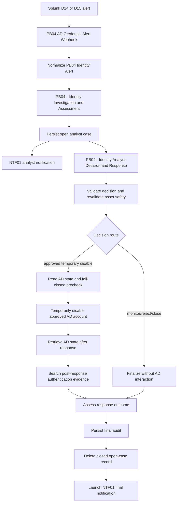

# PB04 - Active Directory Credential Access and Account Abuse

## Final Outcome

PB04 is complete for the current authorized lab scope. It receives D14 and D15
identity alerts from Splunk, normalizes and enriches them, assesses identity
progression, calculates risk, selects an identity response profile, persists an
analyst case, validates a fresh analyst decision, revalidates asset safety, and
performs a narrowly scoped temporary Active Directory account disable only when
every identity and approval gate passes.

Both major response routes were validated:

- **IRP2 monitoring route:** analyst acknowledgement completed without any AD
  write, produced a final audit, and closed the case as monitoring accepted.
- **IRP3 containment route:** analyst-approved temporary disable of `svc_sql`
  succeeded, the disabled AD state was independently retrieved, Splunk found no
  new authentication evidence in a valid post-response window, and the final
  assessment returned `VERIFIED` and `SUCCESS`.

The service account was manually restored after each controlled live test and
confirmed as enabled. Automated credential rotation remains intentionally
deferred.

No password, API key, approval token, cookie, recovered credential, or Kerberos
ticket material is stored in this vault.

## Objective and Scope

PB04 covers Kerberoasting-compatible service-ticket activity and subsequent
use of the targeted service identity. It is an identity-response playbook, not
a generic IP-block workflow.

```text
Detect credential-access behavior
    -> correlate later account use
    -> assess identity stage I1-I4
    -> select IRP response
    -> require analyst approval for identity change
    -> revalidate identity and policy
    -> temporarily disable when authorized
    -> verify AD state and post-response authentication
    -> persist final audit and notify
```

The current scope explicitly excludes:

- Automated service-account password or secret rotation.
- Automated Kerberos-ticket or existing-session termination.
- Automatic network containment as the primary PB04 action.
- AS-REP Roasting response until a validated detection exists.
- Automatic action against privileged, break-glass, unknown, ambiguous, or
  policy-ineligible identities.

## Supported Detections

### D14 - Probable Kerberoasting via RC4 Service Ticket

- Source: Windows Security Event `4769` on `AD-DC01`.
- Detects successful RC4 service-ticket requests for non-machine,
  user-managed SPN accounts.
- Schedule: `3-59/5 * * * *`.
- Search window: `earliest=-30m@m`, `latest=@m`.
- Trigger: results greater than zero.
- Suppression: `detection_key` for 24 hours.
- Initial identity stage: `I1`.
- D14 indicates credential-access exposure; it does not prove password
  recovery or successful account use.

### D15 - Kerberoasted Service Account Subsequently Used

- Correlates D14-compatible Event `4769` evidence with a later successful
  Event `4768` for the targeted account from the same client.
- Correlation window: 48 hours.
- Schedule: `0,15,30,45 * * * *`.
- Severity: Critical.
- Per-result alert with 24-hour `detection_key` suppression.
- Initial identity stage: `I3`.
- D15 establishes subsequent account use but does not by itself prove
  privileged or lateral activity.

Detection engineering details are documented in
[[Phase 3 DMZ Pivot and Internal Access Detections]].

## Identity Stages

| Stage | Meaning |
|---|---|
| `I1` | Probable Kerberoasting or service-ticket exposure |
| `I2` | Elevated Kerberoasting pattern or high-risk credential exposure |
| `I3` | Targeted account subsequently used successfully |
| `I4` | Account use plus corroborating privileged, explicit-credential, process, PowerShell, WinRM, or lateral activity |

I4 requires multiple corroborating post-compromise signals. PB04 does not
escalate a D15 result to I4 solely because the targeted account obtained a TGT.

## Identity Response Profiles

| Profile | Response |
|---|---|
| `IRP0` | Authorized test or benign activity; document and close |
| `IRP1` | Monitor and investigate a lower-risk D14 result |
| `IRP2` | Credential-protection response; dependency review and manual rotation recommendation |
| `IRP3` | Suspected compromise; analyst-approved temporary account disable and verification |
| `IRP4` | Compromise with privileged/lateral evidence; disable identity and escalate endpoint/session investigation |

The implementation uses `IRP` naming. Earlier design notes used `ICP`; those
labels represent the same identity-containment concept but `IRP` is the final
workflow schema.

## Architecture



Shuffle `run_subflow` is asynchronous. Parent workflows do not immediately
consume child outputs. Investigation and response data are therefore passed as
complete context objects or persisted in Shuffle Datastore before continuation.

## Systems and Interfaces

| Component | PB04 role | Interface |
|---|---|---|
| Splunk | D14/D15 alerts, authorization and asset lookups, evidence searches | `10.10.50.10:8089` management API |
| Shuffle | Orchestration, branching, persistence, notification launch | Frontend `10.10.50.30:3001`; backend `10.10.50.30:5001` |
| Active Directory | Identity state retrieval and temporary disable | `AD-DC01` / `10.10.30.10`, LDAP/LDAPS |
| Brevo through NTF01 | Analyst review and final-response email | HTTPS API; credential excluded from vault |
| Shuffle Datastore | Open cases and immutable final response records | Categories described below |

The lab uses a self-signed Splunk certificate, so the Shuffle HTTP nodes use
lab-specific certificate verification settings. This is not a production TLS
recommendation.

## Lookups and Safety Policy

### `pb04_authorized_identity_tests.csv`

The controlled row represents `svc_web` targeting `svc_sql` from the lab
client. Its `enabled` value remained `false` for unauthorized-response
validation. This ensured that the IRP3 test followed the real analyst-approved
containment route rather than an authorized-test closure route.

### `pb04_identity_assets.csv`

The validated `svc_sql` row records:

```text
account_type=SERVICE_ACCOUNT
business_criticality=High
privileged_account=false
break_glass_account=false
temporary_disable_allowed=true
credential_rotation_allowed=false
session_termination_allowed=false
dependency_review_required=true
recovery_method=MANUAL_ACCOUNT_ENABLE
```

The lookup is a current control policy, not a permanent architectural truth.
Automated service-account rotation may be added only after dependency handling,
secret storage, service validation, rollback, and recovery controls exist.

## Main Workflow

Workflow: `PB04 - Active Directory Credential Access and Account Abuse`

| Node | Role |
|---|---|
| `PB04 AD Credential Alert Webhook` | Receives the Splunk alert payload |
| `Normalize PB04 Identity Alert` | Produces the stable PB04 schema and maps D14/D15 to initial stages |
| `Launch PB04 Identity Investigation and Assessment` | Asynchronously launches the investigation continuation |

The webhook has one starting connection, so both detections enter the shared
normalizer. Unsupported alerts are marked fail-closed and cannot reach an
identity-changing action.

## Investigation and Assessment Workflow

Workflow: `PB04 - Identity Investigation and Assessment`

| Node | Role |
|---|---|
| `Receive PB04 Investigation Context` | Unwraps and validates normalized context |
| `Validate Supported D14 D15 Alert` | Allows only valid D14/D15 schema |
| `Check for Existing PB04 Case` | Reads the campaign key from `pb04_identity_cases` |
| `Validate Authorized Identity Test Scope` | Queries the authorization lookup and fails closed on no match |
| `Enrich Target Identity from PB04 Asset Lookup` | Retrieves account type, criticality, dependencies, action policy, and recovery data |
| `Enrich Kerberos and Authentication Evidence` | Searches 4769, 4768, 4624, 4648, 4672, 4688, PowerShell, and WinRM evidence where present |
| `Assess PB04 Identity Outcome` | Determines I1-I4 using alert and corroborating evidence |
| `Calculate PB04 Identity Risk` | Produces score, level, priority, and risk factors |
| `Select PB04 Identity Response Profile` | Selects IRP0-IRP4 and separates executable, deferred, refused, and investigative actions |
| `Build PB04 Analyst Case` | Builds the analyst summary, allowed decisions, case version, and notification context |
| `Persist Open PB04 Case` | Stores the complete case using the campaign lookup key |
| `Persist PB04 Authorized Closure Audit` | Records an authorized-test closure when that route applies |
| `Launch NTF01 PB04 Analyst Decision` | Launches the reusable notification helper |

Open cases use:

```text
category: pb04_identity_cases
key:      PB04-CMP-<campaign hash>
```

The campaign key provides deduplication and safe case versioning. A repeated
campaign updates the existing case instead of creating an unrelated duplicate.

## Analyst Decision and Response Workflow

Workflow: `PB04 - Identity Analyst Decision and Response`

| Node | Role |
|---|---|
| `Receive PB04 Analyst Decision Context` | Normalizes the decision payload and generates a fresh received time |
| `Retrieve Persisted Open PB04 Case` | Loads the authoritative case record by campaign key |
| `Validate PB04 Analyst Decision` | Validates case identity, age, allowed decision, and exact approved actions |
| `Revalidate PB04 Identity Safety` | Re-queries the asset lookup immediately before response |
| `Build PB04 Approved Action Plan` | Builds an immutable action request or a non-execution finalization route |
| `Retrieve Current AD Account State` | Reads the live account before any change |
| `Validate Current AD Account State` | Confirms exact identity, eligibility, UAC state, recovery data, and action-plan integrity |
| `Temporarily Disable Approved AD Account` | Calls the AD app `disable_user` action for the validated `sAMAccountName` |
| `Retrieve AD Account State After Response` | Independently reads the live post-action account state |
| `Search Post-Response Authentication Evidence` | Searches for relevant authentication events after the action-plan time |
| `Assess PB04 Identity Response Outcome` | Combines AD state, action result, and Splunk evidence into VERIFIED/PARTIAL/FAILED |
| `Persist Final PB04 Response Audit` | Writes the final response object before cleanup |
| `Delete Closed PB04 Open Case` | Deletes the campaign-keyed open record only after audit persistence |
| `Launch NTF01 PB04 Final Notification` | Launches the reusable final notification helper |

### Decision Routes

```text
ACKNOWLEDGE_AND_MONITOR
    -> FINALIZE_MONITORING
    -> no AD interaction

APPROVE_ALL_PROPOSED_ACTIONS
    + exact TEMPORARY_ACCOUNT_DISABLE approval
    + fresh case and safety validation
    -> EXECUTE_APPROVED_ACTIONS
    -> live AD precheck
    -> temporary disable

REJECT / FALSE_POSITIVE / ESCALATE
    -> non-execution finalization or manual escalation

Any invalid, stale, mismatched, unsupported, unreachable, ambiguous,
privileged, break-glass, or policy-ineligible condition
    -> STOP_FAIL_CLOSED
```

An already-disabled eligible account uses
`VERIFY_EXISTING_DISABLED_STATE`; PB04 verifies the state without repeating the
write.

## Post-Response Verification

The final Splunk query always returns a structured row, including when no
matching events exist. It records:

```text
runtime_target
containment_iso
authentication_observation
verification_window_valid
total_authentication_events
successful_authentication_events
failed_or_denied_events
explicit_credential_events
privileged_session_events
source_addresses
event_codes
```

The accepted no-event result is:

```text
authentication_observation=NO_POST_RESPONSE_AUTHENTICATION_EVENTS
verification_window_valid=true
successful_authentication_events=0
```

An invalid or missing verification window is never accepted as success. The
response assessor returns partial or failed evidence instead.

Disabling the account prevents new account use but does not revoke existing
Kerberos tickets or terminate established sessions. Final results therefore
retain these required follow-ups:

- Investigate existing sessions and Kerberos tickets.
- Complete service-dependency review.
- Rotate the credential through an approved manual procedure.

## Datastore and Audit Model

| Record | Category | Key |
|---|---|---|
| Open analyst case | `pb04_identity_cases` | Campaign ID |
| Final response audit | `pb04_identity_case_audit` | Case ID |

Finalization order is security-relevant:

```text
Assess response
    -> persist final audit successfully
    -> delete open case
    -> launch final notification
```

The open case is not deleted before the final audit exists.

## Validation History

### IRP2 Monitoring Route

A controlled D14 result produced an I2/P3 case for `svc_sql` with medium risk.
The analyst selected `ACKNOWLEDGE_AND_MONITOR` with no approved actions.

Validated results:

```text
decision_route=FINALIZE_MONITORING
verification_status=NOT_REQUIRED
response_outcome=MONITORING_ACCEPTED
case_status=CLOSED_MONITORING
account_disable_status=NOT_REQUESTED
no_ad_interaction_confirmed=true
```

No identity-changing action ran. The final audit was persisted and the analyst
received the monitoring result during the successful notification test.

### IRP3 Temporary-Disable Route

Final evidence case:

```text
case_id=PB04-CASE-CCE7AF23B308938C
campaign_id=PB04-CMP-CCE7AF23B308938C
detection_id=D15
identity_stage=I3
risk_score=79
risk_level=HIGH
priority=P2
response_profile=IRP3
approved_action=TEMPORARY_ACCOUNT_DISABLE
```

The final live run proved:

1. The persisted case was found and the analyst decision was valid and fresh.
2. Asset safety revalidation returned `PASSED` for the exact service account.
3. The live AD precheck confirmed the account was enabled, nonprivileged,
   non-break-glass, known, and eligible for temporary disable.
4. AD `disable_user` returned result `0` and `description=success`.
5. The independent post-action lookup returned the `ACCOUNTDISABLED` UAC flag.
6. Splunk returned a valid post-response window and no new authentication
   events.
7. The corrected assessor returned:

```text
verification_status=VERIFIED
response_outcome=SUCCESS
case_status=CONTAINED_PENDING_REMEDIATION
account_disable_status=VERIFIED
authentication_status=NO_NEW_AUTHENTICATION_EVIDENCE
issues=[]
```

8. The final audit was written with the case ID.
9. The open campaign record was deleted only after audit success.
10. NTF01 final notification was launched asynchronously.
11. `svc_sql` was manually re-enabled and confirmed `Enabled=True` after the
    controlled test.

## Fail-Closed Tests

PB04 did not merely test its success path. Two infrastructure failures were
introduced or encountered before containment:

- When `AD-DC01` was unreachable, the AD lookup failed and the live precheck
  returned `BLOCKED` / `STOP_FAIL_CLOSED`. No disable action occurred.
- When Splunk management TCP 8089 was unavailable, safety revalidation failed
  before the action plan and no AD action occurred.

Other validated refusal behavior includes unsupported alert rejection,
missing datastore records, stale or mismatched decisions, unknown identities,
ambiguous asset matches, privileged/break-glass accounts, and action-policy
denial.

## Engineering Defects Corrected

### Shuffle Execute Python Top-Level Return

Several early nodes used top-level `return`, which Shuffle rejects. Their
final implementations emit a result and use valid top-level control flow.

### Splunk Form Body and Empty Export Results

The Splunk export endpoint requires a correctly URL-encoded
`application/x-www-form-urlencoded` body. The original long search also used
an unsafe `NOT IN` expression and could return HTTP 200 with an empty body.
The final query uses explicit event flags, a baseline result row, and a fully
encoded request body.

Implementation artifacts retained in the vault root:

```text
PB04_Post_Response_Authentication_Search_revised.spl
PB04_Post_Response_Authentication_HTTP_Body_revised.txt
```

### Response Assessor Variable Binding

Shuffle generated the node variable:

```text
$search_post-response_authentication_evidence
```

The first assessor version incorrectly referenced an underscore-only name.
The corrected binding parses the HTTP result and also requires
`verification_window_valid=true` before accepting authentication evidence.

Final implementation artifact:

```text
PB04_Assess_Identity_Response_Outcome_with_NTF01.py
```

### Shuffle Worker and App Networking

Runtime troubleshooting corrected worker service discovery and verified that
Orborus could reach `shuffle-workers:33333`; HTTP 404 at the root path was the
expected connectivity proof. All Active Directory app replicas were tested
directly against LDAP, and all HTTP app replicas were tested directly against
Splunk TCP 8089 before the final live response.

### Active Directory App Activation

The Active Directory app was made available locally and activated as
`active-directory_1.0.0`. The final Swarm service ran three replicas and all
three passed direct LDAP connectivity checks before live containment.

## Operational Limitations and Follow-Up

- Automated service-account rotation is deferred; manual rotation remains a
  required remediation action.
- Existing Kerberos tickets and sessions are not automatically revoked.
- The Active Directory, Splunk, Shuffle runtime, worker, and app replicas must
  be healthy before a live decision is submitted.
- Brevo delivery was successful in earlier controlled runs but later showed
  intermittent container DNS/connectivity failures. Notification failure does
  not invalidate containment or audit persistence, but delivery should be
  monitored separately.
- The Brevo API credential exposed during troubleshooting must be rotated; the
  credential itself is not recorded here.
- Production deployment should replace lab certificate bypasses with trusted
  TLS certificates.

## Acceptance Criteria

PB04 is accepted for the current lab because it demonstrated:

- Stable D14/D15 normalization.
- Asset-aware identity assessment and risk scoring.
- Case deduplication and versioning.
- Analyst-gated identity changes.
- Fresh safety revalidation immediately before response.
- Exact-account AD precheck and temporary disable.
- Independent post-action AD verification.
- Post-response Splunk evidence with a valid time window.
- Fail-closed behavior during AD and Splunk outages.
- Final audit-before-cleanup ordering.
- Successful IRP2 and IRP3 outcomes.
- Manual recovery of the controlled service account.

No additional PB04 workflow nodes or logic changes are currently required.

## Recommended Evidence Names

```text
SOAR-PB04-01-D14-webhook-normalization.png
SOAR-PB04-02-D15-webhook-normalization.png
SOAR-PB04-03-identity-asset-enrichment.png
SOAR-PB04-04-identity-risk-and-IRP-selection.png
SOAR-PB04-05-analyst-case-P2-IRP3.png
SOAR-PB04-06-analyst-review-email-redacted.png
SOAR-PB04-07-decision-validation.png
SOAR-PB04-08-fresh-safety-revalidation.png
SOAR-PB04-09-live-AD-precheck.png
SOAR-PB04-10-temporary-disable-success.png
SOAR-PB04-11-post-response-UAC-disabled.png
SOAR-PB04-12-post-response-Splunk-verification.png
SOAR-PB04-13-final-verified-success.png
SOAR-PB04-14-final-audit-persisted.png
SOAR-PB04-15-open-case-deleted.png
SOAR-PB04-16-fail-closed-AD-unreachable.png
SOAR-PB04-17-fail-closed-Splunk-unavailable.png
SOAR-PB04-18-account-manually-restored.png
SOAR-PB04-19-IRP2-monitoring-no-AD-action.png
SOAR-PB04-20-final-notification-result-redacted.png
```

Every screenshot must redact credentials, API keys, temporary authorizations,
personal data that is not required for the evidence, and reusable attack
artifacts.

## Related Notes

- [[Splunk and Shuffle Integration]]
- [[Phase 3 DMZ Pivot and Internal Access Detections]]
- [[Detection Coverage Matrix]]
- [[Evidence Index]]
- [[Project Progress]]
- [[Project Dashboard]]
