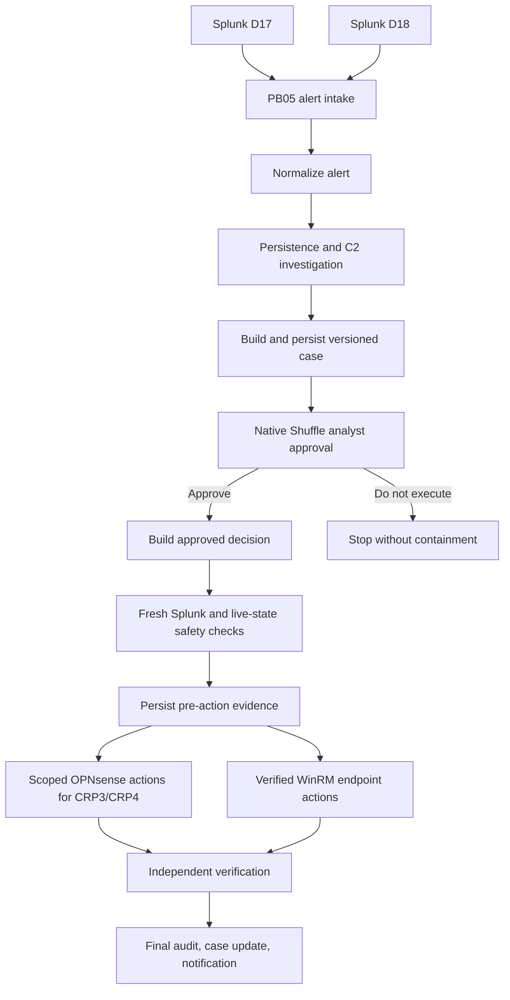

# PB05 - Endpoint Persistence and C2 Investigation and Containment

## Final Outcome

PB05 is complete for the current laboratory scope. It receives D17 and D18
alerts, correlates endpoint persistence and reverse-SOCKS evidence, builds a
versioned analyst case, pauses for a native Shuffle approval, executes only the
approved endpoint and network actions, independently verifies the result, and
persists a final audit record.

The final native-approval run reached:

```text
endpoint_containment_status = VERIFIED
overall_containment          = VERIFIED
verification_status          = VERIFIED
response_outcome             = LAYERED_CONTAINMENT_VERIFIED
case_status                  = CONTAINED_PENDING_REMEDIATION
```

The response removed the exact `PFA-Lab-Tunnel` Run value and stopped the
verified Chisel process. The Chisel binary and persistence script were
deliberately preserved as evidence. CRP3 and CRP4 also validated scoped
OPNsense destination blocking and matching PF-state termination.

No password, API key, session cookie, active approval URL, or authorization
token is stored in this note.

## Objective and Scope

PB05 addresses endpoint persistence and command-and-control activity involving:

- Endpoint: `WIN10-CLIENT01` (`10.10.30.20`)
- Affected identity: `LAB\svc_web`
- User SID: `S-1-5-21-722403993-16450863-2166090910-1106`
- Persistence: HKCU Run value `PFA-Lab-Tunnel`
- Tunnel process: `C:\Users\svc_web\Documents\chisel.exe`
- Persistence script: `C:\Users\svc_web\AppData\Local\PFA-Lab\pfa-tunnel.ps1`
- Controlled callback used during validation: `192.168.111.144:443`

The playbook is deliberately allowlisted and laboratory-specific. It is not a
generic remote PowerShell or arbitrary endpoint execution mechanism.

## Supported Detections

| Detection | Saved search | Initial hypothesis |
|---|---|---|
| D17 | `D17 - Probable Run-Key Persistence Execution via PowerShell` | P2 persistence execution |
| D18 | `D18 - Endpoint Reverse SOCKS Execution with Long-Lived Callback` | P3 active C2 channel |

D18 normalization retains `flow_duration`, `connection_count`, and
`reconnect_count`. Repeated or re-established C2 evidence can promote an
incident to P4. Unsupported detections or incomplete essential context fail
closed.

## Attack-Stage Model

| Stage | Operational meaning in PB05 |
|---|---|
| P1 | Suspicious persistence artifact or lower-confidence execution evidence |
| P2 | Persistence or tunnel execution confirmed |
| P3 | Active C2 channel corroborated |
| P4 | Repeated or re-established C2 activity, including recurrence after containment |
| `UNDETERMINED` | Evidence is incomplete; preserve and escalate without automated writes |

The initial detection stage is only a hypothesis. The investigation workflow
sets the final stage from the combined persistence, process, network, asset,
and timeline evidence.

## Response Profiles

| Profile | Purpose | Executable actions |
|---|---|---|
| CRP0 | Authorized test or benign closure | None |
| CRP1 | Preserve, review, escalate, and monitor | None |
| CRP2 | Endpoint persistence containment | Stop the verified process; remove the exact Run value |
| CRP3 | Layered C2 containment | Block validated destination; terminate matching PF state; stop process; remove Run value |
| CRP4 | Repeated/re-established C2 containment | Same four actions as CRP3, with expanded manual investigation recommendations |

CRP4 recommends manual host-isolation consideration, lateral-movement
investigation, and additional post-exploitation investigation. Host isolation
and binary deletion remain deferred in PB05 v1.

### Canonical Action Names

The case builder can expose descriptive action names. The decision validator
normalizes them to the canonical execution names below:

| Case action | Canonical execution action |
|---|---|
| `BLOCK_VALIDATED_C2_DESTINATION` | `BLOCK_C2_DESTINATION` |
| `TERMINATE_MATCHING_PF_STATE` | `TERMINATE_MATCHING_PF_STATES` |
| `STOP_VERIFIED_TUNNEL_PROCESS` | `STOP_VERIFIED_PROCESS` |
| `REMOVE_EXACT_RUN_VALUE` | `REMOVE_VERIFIED_RUN_VALUE` |

## Architecture



## Workflow Inventory

### PB05 Alert Intake

The intake workflow starts from the Splunk webhook and contains:

1. Webhook trigger
2. `Normalize PB05 Persistence and C2 Alert`
3. `Launch PB05 Persistence and C2 Investigation`

The subflow starts at `Receive PB05 Investigation Context` in
`PB05 - Persistence and C2 Investigation and Assessment`.

### PB05 - Persistence and C2 Investigation and Assessment

Key nodes and responsibilities:

| Node | Responsibility |
|---|---|
| `Receive PB05 Investigation Context` | Decode and validate the normalized alert envelope |
| `Validate Supported D17 D18 Alert` | Reject unsupported or incomplete alerts |
| Existing-case lookup | Retrieve the versioned campaign case when present |
| Authorized-test lookup | Evaluate `pb05_authorized_persistence_c2_tests.csv` |
| Endpoint asset/safety lookup | Load the allowlisted response policy |
| Persistence/process/network enrichment | Corroborate the alert against available telemetry |
| `Build PB05 Persistence C2 Timeline` | Build a combined evidence timeline and action targets |
| `Assess PB05 P1 P4 Attack Stage` | Select the evidence-derived stage |
| Risk calculation | Calculate score, level, and priority |
| `Select PB05 Containment Response Profile` | Select CRP0-CRP4 |
| `Build PB05 Analyst Case` | Build the analyst-facing, versioned case |
| `Persist Open PB05 Case` | Persist the current case before any decision |
| `PB05 Analyst Approval` | Pause for native Shuffle user input when action approval is required |

### PB05 - Analyst Approval Notification

This workflow is launched from the User Input node as a subflow. It contains:

1. `Build PB05 Approval Email`
2. `Launch NTF01 PB05 Approval`

The extra `PB05_Approval_Input` trigger was removed because the User Input node
already supplies the case information to the selected subflow.

The approval email exposes only the one-time Shuffle **Approve** and
**Do not execute** links. Shuffle records the authenticated click identity,
time, source metadata, and note in `click_info`; report evidence must redact
unnecessary personal or authorization data.

The generated form links originally used backend port `5001` and returned
`404 page not found`. `Build PB05 Approval Email` now rewrites `/forms/` URLs
to the Shuffle frontend base `http://10.10.50.30:3001`.

After approval, the parent workflow runs:

1. `Build PB05 Approved Decision`
2. `Launch PB05 Approved Response`

The builder copies the current case's exact executable action set, records the
native Shuffle approval source, and refuses to build an executable decision if
the case, status, response profile, or click metadata is invalid.

### PB05 - Endpoint Analyst Decision and Layered Response

The approved-response subflow starts at
`Receive PB05 Analyst Decision Context` and follows this order:

| Order | Node |
|---:|---|
| 1 | `Receive PB05 Analyst Decision Context` |
| 2 | `Retrieve Persisted Open PB05 Case` |
| 3 | `Validate PB05 Analyst Decision` |
| 4 | `Revalidate PB05 Endpoint Response Safety` |
| 5 | `Build PB05 Approved Action Plan` |
| 6 | Persist the PB05 pre-action evidence snapshot |
| 7 | `Confirm PB05 Pre-Action Evidence Persistence` |
| 8 | `Block PB05 C2 Destination` when required |
| 9 | `Retrieve PB05 C2 Block Alias State` |
| 10 | `Validate PB05 C2 Destination Block` |
| 11 | `Terminate PB05 Matching PF States` |
| 12 | `Query PB05 PF States After Termination` |
| 13 | `Validate PB05 PF State Termination` |
| 14 | `Retrieve Current PB05 Endpoint State` |
| 15 | `Stop Verified PB05 Process` |
| 16 | `Remove Verified PB05 Run Value` |
| 17 | `Verify PB05 Endpoint State` |
| 18 | `Assess PB05 Layered Response Outcome` |
| 19 | Persist final response audit and update the final case state |
| 20 | `Launch NTF01 PB05 Final Response` |

Network actions are skipped for CRP2. Endpoint removal proceeds only after the
required earlier action has either completed successfully or verified that the
target is already absent.

## Endpoint Response App

PB05 uses a custom restricted Shuffle application:

| Item | Value |
|---|---|
| App source | `PB05 Endpoint Response App` |
| Image | `frikky/shuffle:pb05-endpoint-response_1.0.0` |
| Swarm service | `pb05-endpoint-response_1-0-0` |
| Replicas | 3 |
| Transport | WinRM HTTP 5985 with NTLM and message encryption |
| Management identity | Dedicated `LAB\svc_soar_pb05` account; secret stored only in Shuffle authentication |

Implemented app actions:

- `get_pb05_endpoint_state`
- `stop_verified_process`
- `remove_verified_run_value`
- `verify_pb05_endpoint_state`

The app uses a compressed Base64 PowerShell launcher to stay below WinRM
command-line limits. If `Win32_Process.ExecutablePath` is blank, it derives the
candidate path from the command line, then still verifies the PID, creation
time, owner, full command line, callback, and allowlisted path before stopping
the process.

The process stop refuses execution if the live process differs from the
persisted evidence. Run-value removal verifies the exact name and data before
deletion. Final verification confirms that the matching process did not
restart, the Run value is absent, and the callback is not observed at the
endpoint.

## OPNsense Response

PB05 uses the scoped alias `SOAR_PB05_C2_BLOCKLIST`.

| Operation | API path |
|---|---|
| Add validated destination | `POST /api/firewall/alias_util/add/SOAR_PB05_C2_BLOCKLIST` |
| Read alias state | `GET /api/firewall/alias_util/list/SOAR_PB05_C2_BLOCKLIST` |

PB05 terminates only PF states matching the validated response target. It does
not flush the complete firewall state table. Alias membership and PF-state
absence are independently queried and validated after the write.

All three Shuffle HTTP application replicas successfully reached the OPNsense
API during validation. The lab callback entry may remain in the alias until a
deliberate test reset is performed.

## Safety Policy and Lookups

### `pb05_authorized_persistence_c2_tests.csv`

This lookup defines the controlled exercise scope for the endpoint, callback,
allowed detections, activities, time window, and owner. Its test row was kept
`enabled=false` during the unauthorized analyst-gated response tests.

### `pb05_endpoint_assets.csv`

The endpoint asset lookup restricts the response to the known host, address,
user/SID, process path, Run value, script path, and approved action policy. The
validated policy allowed process stop, exact persistence removal, scoped C2
blocking, and matching PF-state termination. It denied automated host
isolation and binary deletion and required evidence and management-access
preservation.

The live safety revalidation returned `PASSED` only after the runtime case,
campaign, endpoint, user, SID, asset policy, action targets, and recovery data
matched the persisted case.

## Evidence and Audit Persistence

| Data | Datastore category | Key |
|---|---|---|
| Open/versioned case | `pb05_persistence_c2_cases` | Campaign ID |
| Immutable pre-action snapshot | `pb05_preaction_evidence` | `<case>-<decision>-PREACTION` |
| Final response audit | `pb05_endpoint_response_audit` | Campaign ID |
| Final case state | `pb05_persistence_c2_cases` | Campaign ID |

The campaign identity is based on endpoint host plus affected user. A repeated
D17 or D18 updates the existing case and increments its version instead of
creating unrelated cases. No response write can execute until the pre-action
snapshot has been persisted and confirmed.

## Live Validation Results

### CRP1 - Preserve and Escalate

- An incomplete D18 correlation produced `UNDETERMINED`.
- The case became `AWAITING_ANALYST_ESCALATION` at P1 priority.
- No executable action was exposed.
- The analyst notification was delivered successfully.

This validates the fail-closed/manual-review route.

### CRP2 - Endpoint Persistence Containment

- D17 produced P2, `HIGH`, P2 priority, and `AWAITING_ANALYST_APPROVAL`.
- The approved actions were process stop and exact Run-value removal.
- Process stopping returned `STOPPED_AND_VERIFIED`; a repeated run safely
  returned `ALREADY_ABSENT`.
- Run-value removal returned `REMOVED_AND_VERIFIED`.
- Endpoint verification returned `VERIFIED` with no process restart and no Run
  value.
- Windows-side verification showed zero matching Chisel processes and
  `RunValuePresent=False` while the binary and script remained present.

### CRP3 - Layered C2 Containment

- D18 produced P3 and CRP3.
- Destination block, matching PF-state termination, verified process stop, and
  exact Run-value removal all completed and verified.

### CRP4 - Repeated C2 Containment

- A controlled D18 recurrence retained a 900-second flow duration, five
  connections, and three reconnects.
- The investigation promoted the case to P4 with `CRITICAL` risk and P1
  priority.
- All four network and endpoint action results were `VERIFIED`.
- Overall containment and verification were `VERIFIED` and the case became
  `CONTAINED_PENDING_REMEDIATION`.
- Host isolation, binary deletion, lateral-movement investigation, and broader
  post-exploitation work remained manual/deferred by policy.

### Native Analyst Approval

The native approval route was live-validated on 2026-09-06:

1. The investigation persisted the open case.
2. `PB05 Analyst Approval` paused and sent an email through the approval
   notification subflow and NTF01.
3. The corrected frontend link opened the Shuffle form directly.
4. An authenticated analyst clicked **Approve**.
5. Shuffle recorded the click metadata and built the exact approved decision.
6. `Launch PB05 Approved Response` started the layered-response workflow.
7. Decision validation, fresh safety revalidation, pre-action evidence,
   containment, endpoint verification, final audit, case update, and final
   notification all completed successfully.

No analyst decision webhook or manual `curl` command was required.

## Fail-Closed Tests and Corrected Defects

| Condition or defect | Result |
|---|---|
| Unsupported/mismatched D17 or D18 search name | Rejected; exact saved-search names restored |
| Missing host, user, callback, or essential action target | Investigation or action plan blocked |
| Unsupported action aliases/action-set mismatch | Canonical action mapping added |
| Splunk revalidation URI/body encoding error | Request encoding and runtime bindings corrected |
| Empty Splunk diagnostic result | Action planning blocked until the real safety row returned |
| Missing D17 action targets after enrichment | Source-alert targets preserved when enrichment returned explicit no-match data |
| Shuffle result too large | Oversized nested outputs reduced before downstream handling |
| WinRM command line too long | Compressed Base64 launcher implemented |
| PowerShell parser error | Launcher syntax corrected and retested |
| Process state/path/owner mismatch | Stop refused with `REFUSED_PROCESS_STATE_CHANGED` |
| Blank `ExecutablePath` from WMI | Path recovered from command line, then fully revalidated |
| Windows VM or AD unavailable/broken secure channel | Endpoint actions stopped until connectivity and trust were restored |
| Stale Shuffle networks after VM restart | Backend/orborus connectivity repaired and services revalidated |
| Worker attempted unnecessary image download | `SHUFFLE_AUTO_IMAGE_DOWNLOAD=false` applied |
| Approval form URL used backend port 5001 | Link builder now targets frontend port 3001 |
| Intermittent Brevo DNS failure | Container DNS restored; later notifications returned HTTP 201 |

## Limitations and Deferred Work

- The native **Do not execute** option aborts the workflow but does not yet map
  to rich persisted decisions such as `REJECT`, `FALSE_POSITIVE`, or
  `ESCALATE`. A custom Shuffle Form or ITSM integration is the preferred future
  enhancement.
- Automated host isolation and binary/script deletion are intentionally outside
  PB05 v1.
- One endpoint-only verification occurred while Kali was offline, so direct
  callback data-plane testing was unavailable in that run. CRP3/CRP4 still
  independently verified the OPNsense alias and PF-state controls.
- The authorized-test CRP0 route remains optional test coverage, not a blocker
  for the accepted analyst-gated containment paths.
- Recovery and cleanup of lab artefacts remain deliberate manual actions.

## Acceptance Criteria

- [x] D17 and D18 normalize into one stable campaign model.
- [x] Unsupported or incomplete alerts fail closed.
- [x] Cases are deduplicated, versioned, and persisted.
- [x] CRP1 through CRP4 decision routes were exercised.
- [x] Native Shuffle approval launches the response automatically.
- [x] Fresh safety revalidation occurs after approval.
- [x] Pre-action evidence is persisted before every write.
- [x] OPNsense changes are scoped and independently verified.
- [x] Endpoint actions verify exact live process and persistence state.
- [x] Binary and script evidence are preserved.
- [x] Final audit, final case update, and notification complete.
- [x] Windows-side post-check confirms process and Run-value absence.

## Recommended Evidence

Use the PB05 filenames listed in [[Evidence Index]]. Redact passwords, API
credentials, authorization query strings, cookies, personal recipient data,
and unnecessary source metadata before including screenshots in the report.

## Related Notes

- [[10 - Persistence and C2 Simulation]]
- [[Splunk Data Sources and Searches]]
- [[Detection Coverage Matrix]]
- [[Splunk and Shuffle Integration]]
- [[Evidence Index]]
- [[Project Progress]]
