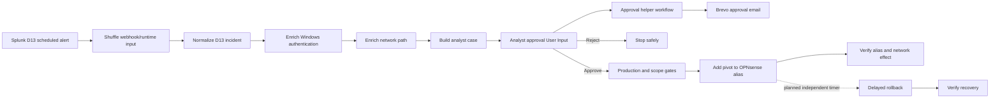
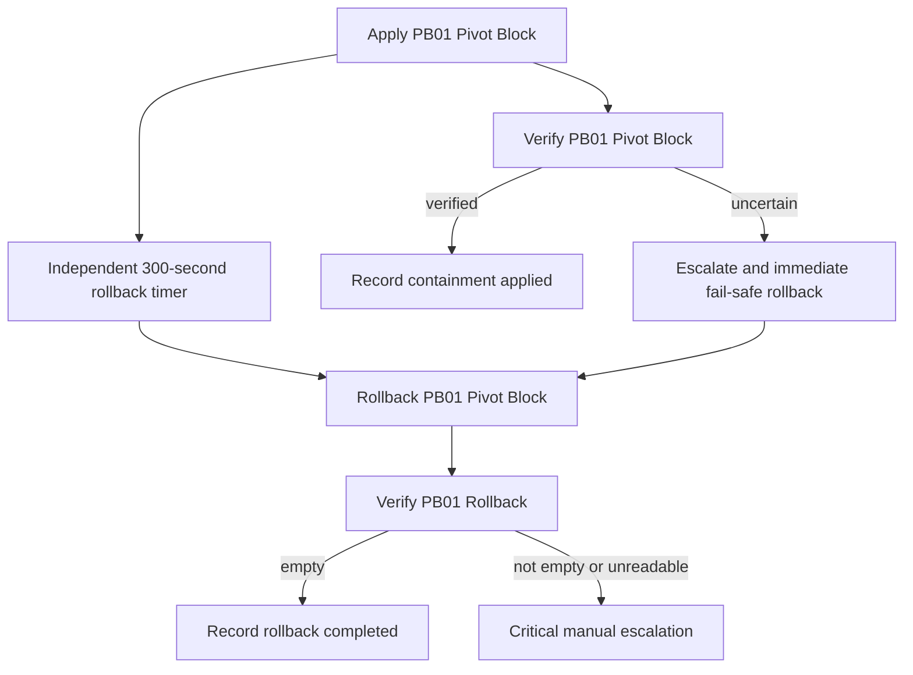

# Splunk and Shuffle Integration

> [!note] Historical status
> This note preserves the PB01 integration experiment and its engineering
> lessons. PB01 was not retained as the project's main response design after
> supervisor feedback. PB02 and PB03 superseded it for network/web response,
> and [[PB04 - Active Directory Credential Access and Account Abuse]] is the
> completed identity-response playbook. [[PB05 - Endpoint Persistence and C2 Investigation and Containment]]
> completes the current endpoint persistence/C2 scope with native analyst
> approval and verified layered response. The PB01 rollback redesign below is
> not the current next step unless explicitly resumed.

## Current Outcome

The original Splunk-to-Shuffle connectivity proof has been extended into
`PB01 - D13 Web Compromise to Internal Access`, a human-approved response
playbook for the highest-confidence Phase 3 attack-chain correlation. PB01 now
receives a D13-shaped result, normalizes it, enriches Windows and network
evidence through the Splunk management API, builds an analyst case, sends an
approval request through Brevo, applies a narrowly scoped OPNsense control,
and verifies the resulting network effect.

The live containment test successfully blocked new TCP connections from the
DMZ pivot `10.10.60.10` to WIN10-CLIENT01 `10.10.30.20` on WinRM TCP 5985.
The automatic normal-rollback path is **not yet accepted**: a Shuffle branch
evaluation issue prevented the delayed rollback from being reached in the
latest run. The alias entry was removed manually and connectivity was restored.
Work is paused at the rollback-topology redesign described below.

No API keys, SMTP credentials, passwords, authorization tokens, temporary
approval URLs, cookies, or other secrets are stored in this vault.

## PB01 Objective

PB01 responds to this correlated path:

```text
External peer 192.168.111.144
    -> compromised DVWA/DMZ pivot 10.10.60.10
    -> WIN10-CLIENT01 10.10.30.20 TCP/5985
    -> successful network authentication as svc_web
```

The playbook follows the response model:

```text
Detect -> Normalize -> Enrich -> Build case -> Human approve
       -> Validate scope -> Contain -> Verify -> Roll back -> Audit
```

Containment is deliberately human-controlled because an incorrect firewall,
account, or endpoint action could disrupt legitimate activity. Detection and
investigation are automatic; the security decision remains manual.

## Architecture



## Systems and Interfaces

| Component | Role | Interface |
|---|---|---|
| Splunk | D13 detection, webhook source, evidence enrichment | Web UI `10.10.50.10:8000`; management API `10.10.50.10:8089` |
| Shuffle | Orchestration, approval, gating, audit objects | Frontend `10.10.50.30:3001`; backend `10.10.50.30:5001` |
| Brevo | Sends analyst approval messages | HTTPS API `/v3/smtp/email` |
| OPNsense | Applies and removes the scoped network control | API on `10.10.70.1` |
| DMZ/DVWA | Compromised pivot represented by D13 | `10.10.60.10` |
| WIN10-CLIENT01 | Internal target | `10.10.30.20`, WinRM TCP 5985 |

## Main Workflow Nodes

### Entry and Normalization

#### Webhook / Runtime Argument

Receives the Splunk saved-search context and result fields. Development tests
used controlled runtime arguments with the exact D13 search name. The live
response gate additionally required:

```text
validation_mode=production
response_action_mode=live
```

#### Normalize D13 Incident

Transforms the Splunk result into a stable PB01 schema. It assigns the
playbook ID, case title, entities, MITRE techniques, response mode, and initial
containment state. This is a `Repeat back to me` data-transformation node; it
does not change an external system.

### Automated Enrichment

#### Enrich Windows Authentication

Queries Splunk through the management API for relevant Windows Security events
on WIN10-CLIENT01. The enrichment retains the account, source address, event
code, logon type, authentication package, and time. It is intended to answer
whether the suspicious network path was followed by endpoint authentication.

#### Enrich Network Path

Queries Splunk for OPNsense evidence related to the DMZ pivot, internal target,
and management service. It confirms the observed source, destination, port,
action, and timing of the DMZ-to-internal connection.

Both enrichment actions returned HTTP 200 and populated result arrays during
the controlled tests.

### Case Construction and Approval

#### Build D13 Analyst Case

Combines normalized data and enrichment results into a P1 analyst case with:

- Case ID and title.
- Critical severity and High confidence.
- Affected path, host, and account.
- Detection summary and Splunk results link.
- Windows and network evidence.
- MITRE ATT&CK techniques `T1190`, `T1572`, `T1021.006`, and `T1078`.
- Recommended investigation actions.
- Approval question and pending decision state.

#### Analyst Approval - Scoped Containment

A Shuffle User Input trigger pauses the parent workflow and generates temporary
Continue and Abort paths. Approval does not itself perform containment; it
only permits the downstream safety gates to evaluate.

#### Record Analyst Approval

Records the decision, analyst identity, decision time, source IP, optional
note, and validation mode. It explicitly distinguishes approval from execution:

```text
approval_recorded=true
containment_executed=false
```

### Scope and Production Gates

#### Prepare Scoped Containment

Creates a proposed, incident-specific response plan:

```text
source pivot = 10.10.60.10
target       = 10.10.30.20
protocol     = TCP
port         = 5985
duration     = temporary
```

#### Validate Scoped Containment Eligibility

Checks the approved pivot, target, hostname, account, planned action,
verification requirement, and rollback requirement before any firewall write.

#### Verify OPNsense Alias Access

Performs a read-only list request against the external alias. It proves that
the dedicated OPNsense API identity can reach only the required PF-table
function and that the initial alias state is known.

#### Authorize Live Containment

This is the final fail-closed gate. All conditions must match:

```text
OPNsense API status = 200
analyst decision = Approved
validation mode = production
search name = D13 - Correlated Web Compromise to Internal Access
response action mode = live
```

The dry-run test intentionally omitted `response_action_mode`; the write node
was skipped, proving the gate failed closed.

### Containment and Verification

#### Apply PB01 Pivot Block

Adds the validated pivot to the OPNsense external alias:

```text
POST /api/firewall/alias_util/add/SOAR_PB01_BLOCKED_PIVOTS
address=10.10.60.10
```

The API returned HTTP 200 with `status=done` in both live tests.

The pre-positioned OPNsense rule is above the related pass rule and blocks only:

```text
TCP 10.10.60.10 -> 10.10.30.20:5985
```

It does not disable the account, isolate the endpoint, block the entire DMZ,
or affect unrelated internal services.

#### Verify PB01 Pivot Block

Lists the alias after the write. The successful live result was HTTP 200 with
`total=1` and `rowCount=1`. Independent technical validation confirmed:

```text
pfctl table entry: 10.10.60.10
fresh DMZ TCP/5985 connection: timed out
```

An unsupported nested list comparison using `body.rows.0.ip` initially caused
a false verification failure. It was replaced with aggregate alias-count
checks, but the latest run still ended after this node because neither outgoing
Shuffle branch evaluated as true. This branch behavior remains unresolved.

#### Record Containment Applied

Intended to record the case, control, validated pivot, target, port,
verification result, and rollback requirement. It is an audit node, not the
firewall action. The latest execution did not reach it because of the branch
issue above.

### Rollback and Escalation

#### Rollback PB01 Pivot Block

Deletes `10.10.60.10` from the external alias after a 300-second delay:

```text
POST /api/firewall/alias_util/delete/SOAR_PB01_BLOCKED_PIVOTS
```

#### Verify PB01 Rollback

Lists the alias and expects `total=0`. A separate network test expects a fresh
DMZ connection to WinRM to succeed again.

#### Record Rollback Completed

Records rollback execution, the removed pivot, final verification state, and
restored case status.

#### Escalation Nodes

- `Escalate Containment Write Failure`: add request did not complete.
- `Escalate Containment Verification Failure`: write completed but the
  expected alias state could not be confirmed.
- `Fail-Safe Rollback Unverified Block`: immediately removes an unverified
  entry.
- `Escalate Incomplete Rollback`: deletion returned but the alias remained
  populated.
- `Escalate Rollback Verification Error`: the final firewall state could not
  be read reliably.

## Approval Helper Workflow

The separate workflow `PB01 - Analyst Approval Request` performs notification,
not containment.

| Node | Role |
|---|---|
| Receive Approval Context | Receives the incident summary and temporary Continue/Abort paths from the waiting parent workflow |
| Build Approve URL | Rewrites the generated frontend path to the reachable Shuffle frontend on TCP 3001 while preserving its temporary authorization parameters |
| Build Reject URL | Builds the equivalent `answer=false` rejection link |
| Send PB01 Approval via Brevo API | Sends the analyst message with case context and Approve/Reject links |

Brevo HTTPS delivery returned HTTP 201 with a message ID, and the approval
email was received successfully. An earlier SMTP implementation was abandoned
after routing and sender-validation issues; no SMTP or API secrets are stored
here.

## OPNsense Least-Privilege Control

### External Alias

```text
SOAR_PB01_BLOCKED_PIVOTS
```

The alias is normally empty. Shuffle temporarily adds only the approved pivot.

### Firewall Rule

```text
block drop in log quick on em2 inet proto tcp
from <SOAR_PB01_BLOCKED_PIVOTS>
to 10.10.30.20 port 5985
```

The block rule is ordered above the existing DMZ-to-WinRM pass rule.

### API Identity

The dedicated account `svc_shuffle_pb01` is not an administrator. It retains
only the PF-table IP-address privilege needed for alias operations. Its API
key and secret are excluded from Obsidian, screenshots, and version control.

## Validation History

### Integration and Enrichment

- Splunk scheduled-alert webhooks created Shuffle executions.
- Splunk REST authentication was corrected without documenting credentials.
- Windows and OPNsense enrichment returned HTTP 200.
- D13 payload normalization and analyst-case construction produced the
  expected entities and MITRE mappings.

### Approval Gate

- A synthetic validation reached the User Input node.
- Approve resumed the parent workflow.
- Reject stopped it safely.
- The Brevo API sent a professional approval message with both decisions.
- Approval was recorded without falsely claiming that containment had run.

### Dry-Run Gate

- The production-shaped dry run omitted `response_action_mode=live`.
- The live authorization node was skipped.
- No OPNsense write occurred.

### First Live Containment Test

- OPNsense add request returned `status=done`.
- Alias list returned one entry.
- Nested `rows.0.ip` evaluation caused a false verification failure.
- The immediate fail-safe rollback executed successfully.
- Final alias count was zero.

### Second Live Containment Test

- Baseline alias was empty.
- Baseline DMZ-to-WinRM connection succeeded.
- Analyst approved the emailed request.
- Production gates passed.
- OPNsense add request returned `status=done`.
- Alias contained `10.10.60.10`.
- A fresh DMZ-to-WinRM connection timed out, proving effective containment.
- Shuffle ended after the verification node because neither outgoing branch
  matched.
- The normal delayed rollback was therefore never reached.
- The pivot was manually deleted from the PF table.
- A fresh DMZ-to-WinRM connection succeeded again, proving recovery.

## Failure Analysis and Safety Lesson

The last execution showed that Shuffle `FINISHED` means no additional node was
eligible to run; it does **not** prove that every intended response stage
completed. The normal rollback was downstream of successful verification:

```text
Verify -> Record containment -> wait 300 seconds -> Rollback
```

When verification branching failed, rollback was never scheduled. This is an
orchestration design weakness even though the actual containment control was
correctly scoped and manually recovered.

## Exact Pause Point and Required Redesign

Work is intentionally paused before further live tests. On resumption:

1. Confirm the OPNsense alias is empty and WinRM is reachable from the DMZ.
2. Verify whether the existing `Record Containment Applied -> Rollback` edge
   was removed before the pause.
3. Connect successful `Apply PB01 Pivot Block` directly to a delayed rollback
   path so cleanup is independent of verification and documentation.
4. Preserve a parallel immediate fail-safe rollback for uncertain states.
5. Correct and separately test the success, empty-alias, and API-error
   verification branches.
6. Run a dry test before another analyst-approved live test.
7. Accept PB01 only after automatic containment, verification, delayed
   rollback, recovery verification, and audit recording all complete.

Target topology:



## Operational Limitation

Adding the alias blocks new matching TCP connections. It may not terminate an
already established PF state or existing WinRM session. Validation therefore
uses fresh connection attempts. The playbook does not flush all firewall
states; any future immediate-session termination must use a separately tested,
targeted state-removal design.

## Recommended Evidence Names

```text
SOAR-PB01-01-D13-webhook-schema.png
SOAR-PB01-02-normalized-incident.png
SOAR-PB01-03-windows-enrichment.png
SOAR-PB01-04-network-enrichment.png
SOAR-PB01-05-analyst-case.png
SOAR-PB01-06-brevo-approval-email.png
SOAR-PB01-07-approval-record.png
SOAR-PB01-08-production-gate.png
SOAR-PB01-09-opnsense-least-privilege-user-redacted.png
SOAR-PB01-10-opnsense-alias-and-rule.png
SOAR-PB01-11-live-alias-entry.png
SOAR-PB01-12-live-winrm-timeout.png
SOAR-PB01-13-manual-rollback-alias-empty.png
SOAR-PB01-14-post-rollback-winrm-restored.png
SOAR-PB01-15-rollback-design-gap.png
```

Every screenshot must exclude API keys, SMTP credentials, temporary approval
tokens, passwords, cookies, and personal information that is unnecessary for
the defensive evidence.
